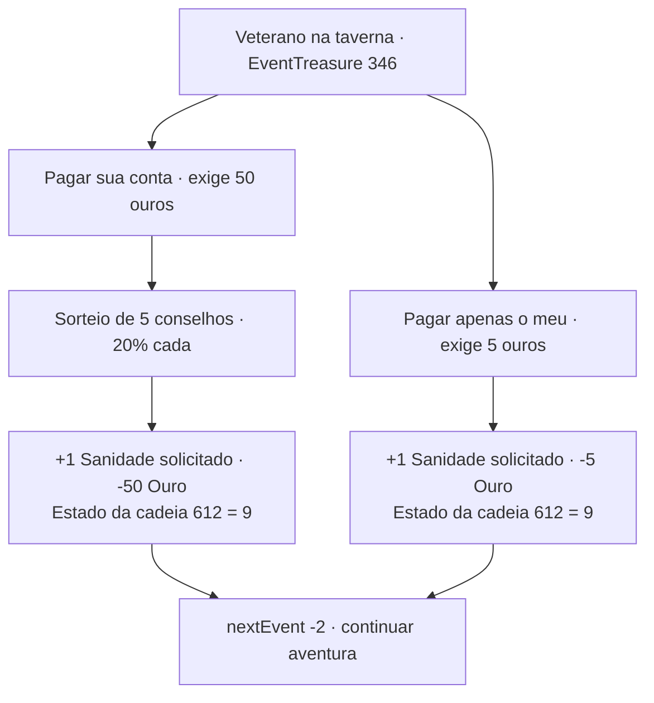

# Aventureiro veterano na taverna

Nome editorial para o encontro `pt:EventTreasure:346`; fonte `EventTreasure4`, versão 1.2.47. As escolhas mantêm o texto da tradução do jogo. Status: analisado estaticamente; ainda não testado no emulador.

## Comparação dos resultados registrados

“Pagar apenas o meu” gasta 5 ouros; “Pagar sua conta” gasta 50. Ambas as escolhas solicitam +1 de Sanidade e definem o estado interno da cadeia 612 como 9. A diferença é de **45 ouros**.

O ganho efetivo de sanidade pode ser limitado pelo máximo do personagem. A tabela registra alterações imediatas e não atribui preferência às opções.

## Entrada

O jogo exige as duas condições:

- Estado interno `chainEventList[612] == 0`.
- Pelo menos 5 ouros (`GetUserData(4) >= 5`).

A opção de pagar a conta do veterano exige pelo menos 50 ouros. São condições de elegibilidade; não garantem que o encontro será sorteado.

## Comparação completa

| Escolha | Requisito | Resultados possíveis | Efeitos registrados |
|---|---|---|---|
| Pagar sua conta | Ouro ≥ 50 | Cinco conselhos, cada um com peso 1 e probabilidade estática de 1/5 | Solicita +1 Sanidade, −50 Ouro; cadeia 612 recebe estado 9 |
| Pagar apenas o meu | Ouro ≥ 5 | Um resultado, sem teste aleatório | Solicita +1 Sanidade, −5 Ouro; cadeia 612 recebe estado 9 |

Os cinco conselhos falam de escolha de armas, vampiros, trolls, estabilidade e grifos. Todos têm o mesmo requisito vazio, tipo 2 e o mesmo código de recompensa: `0_1_1|0_4_-50|5_612_9`. A escolha econômica usa `0_1_1|0_4_-5|5_612_9`. Nenhuma opção concede item ou EXP por esse campo.

## Mapa

## Evidência

JSON original: `dados-extraidos/1.2.47/TextAsset/data/1344_EventTreasure4.txt`, registro de ID 346. Versão enriquecida: `database/events.pt.decoded.json`. Interpretação dos campos: [regras confirmadas](regras-confirmadas.md).

O [mapeamento completo deste encontro](../mapas/1.2.47/pt/EventTreasure/0346.md) inclui todos os textos dos resultados.
