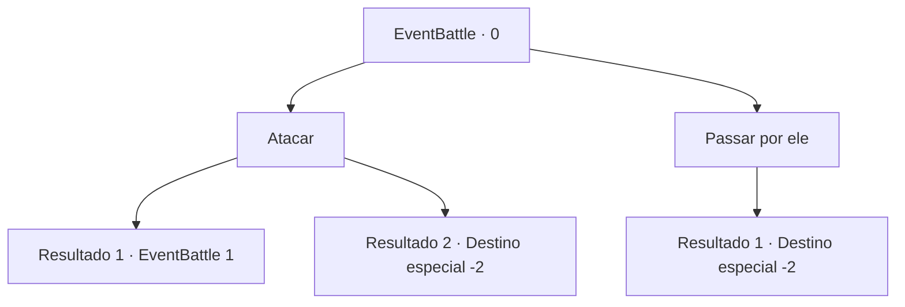

# Eventos de combate · 0

[Índice da tabela](index.md) · [Índice geral](../index.md)

ID: `pt:EventBattle:0` · Fonte: `EventBattle4` · Versão: 1.2.47.

Mapeamento estático dos arquivos; a disponibilidade e a execução dependem do estado da run.

## Texto do evento

Uma besta uiva na floresta, quebrando o silêncio da noite. Cuidadosamente, você vai em direção à origem do som. De longe, você vê {0}s ferozmente devorando alguma presa. Eles estão muito ocupados com suas refeições para perceber você. 

## Dados de entrada

```json
{
  "id": 0,
  "grade": 1,
  "monster": "1|3",
  "required": "2_2_30"
}
```

## Mapa das escolhas



## Escolhas e resultados

### Escolha 1

Atacar

Requisitos e outros campos da escolha:

```json
{
  "required": ""
}
```

#### Resultado 1.1

Você se aproxima de um deles lentamente e o golpeia. Mas não foi o suficiente para derrubá-lo. Os outros se juntam a ele e atacam você.

Continuação registrada: [Evento 1](0001.md) na mesma tabela.

```json
{
  "required": "",
  "chance": "7",
  "nextEvent": 1,
  "type": 1,
  "reward": "6_1_0",
  "place": 1
}
```

#### Resultado 1.2

Você se aproxima de um deles lentamente e o golpeia na cabeça. Ele cai, jorrando sangue por todo lado. Os outros se assustam e fogem.

Continuação registrada: [Destino especial `-2`](../destinos-especiais.md).

```json
{
  "required": "",
  "chance": "1|0_5_1",
  "nextEvent": -2,
  "type": 0,
  "reward": "0_2_1|0_4_4"
}
```

### Escolha 2

Passar por ele

Requisitos e outros campos da escolha:

```json
{
  "required": ""
}
```

#### Resultado 2.1

Você os deixa em paz e volta para retomar sua caminhada.

Continuação registrada: [Destino especial `-2`](../destinos-especiais.md).

```json
{
  "required": "",
  "chance": "1",
  "nextEvent": -2,
  "type": 2,
  "reward": ""
}
```

## Referências que chegam a este evento

Nenhum `nextEvent` positivo da mesma tabela aponta para este nó. Isso não prova que seja inacessível: sorteio e estado de história podem selecioná-lo.

