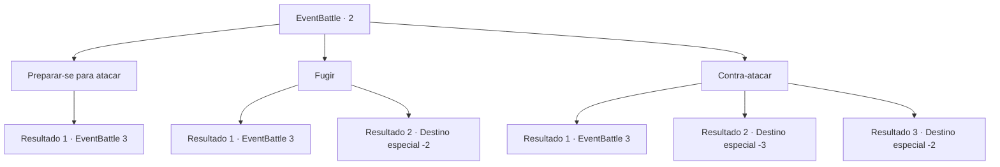

# Eventos de combate · 2

[Índice da tabela](index.md) · [Índice geral](../index.md)

ID: `pt:EventBattle:2` · Fonte: `EventBattle4` · Versão: 1.2.47.

Mapeamento estático dos arquivos; a disponibilidade e a execução dependem do estado da run.

## Texto do evento

Você caminha para dentro de uma densa floresta. Todos os seus sentidos estão afiados, quando você escuta um pequeno sussuro. {0} pula dos arbustos assim que você pega a sua arma.

## Dados de entrada

```json
{
  "id": 2,
  "grade": 1,
  "monster": "0_1_10|1_1_10|3_1_10|7_1_10|8_0_10|22_0_10",
  "required": ""
}
```

## Mapa das escolhas



## Escolhas e resultados

### Escolha 1

Preparar-se para atacar

Requisitos e outros campos da escolha:

```json
{
  "required": ""
}
```

#### Resultado 1.1

Você estende sua arma e adota uma postura de combate. Como esperado, o {0} ataca você.

Continuação registrada: [Evento 3](0003.md) na mesma tabela.

```json
{
  "required": "",
  "chance": "1",
  "nextEvent": 3,
  "type": 2,
  "reward": "6_1_0",
  "place": 1
}
```

### Escolha 2

Fugir

Requisitos e outros campos da escolha:

```json
{
  "required": ""
}
```

#### Resultado 2.1

Você consegue se esquivar do ataque surpresa dele e começa a correr. Mas a criatura logo alcança você.

Continuação registrada: [Evento 3](0003.md) na mesma tabela.

```json
{
  "required": "",
  "chance": "10",
  "nextEvent": 3,
  "type": 1,
  "reward": "6_1_0",
  "place": 1
}
```

#### Resultado 2.2

Você consegue se esquivar do ataque surpresa dele e começa a correr.

Continuação registrada: [Destino especial `-2`](../destinos-especiais.md).

```json
{
  "required": "",
  "chance": "1|0_6_1",
  "nextEvent": -2,
  "type": 0,
  "reward": ""
}
```

### Escolha 3

Contra-atacar

Requisitos e outros campos da escolha:

```json
{
  "required": "1_6_9"
}
```

#### Resultado 3.1

Você prevê o ataque do {0} e o contra-ataca. Mas você erra o golpe e dá outra oportunidade de ataque para o {0}. O {0} investe de novo e acerta você.

Continuação registrada: [Evento 3](0003.md) na mesma tabela.

```json
{
  "required": "1_0_2",
  "chance": "7",
  "nextEvent": 3,
  "type": 1,
  "reward": "6_1_0|0_0_-1",
  "place": 1
}
```

#### Resultado 3.2

Você prevê o ataque do {0} e o contra-ataca. Mas você erra o golpe e dá outra oportunidade de ataque para o {0}. O {0} investe de novo e acerta você. Você fica gravemente ferido.

Continuação registrada: [Destino especial `-3`](../destinos-especiais.md).

```json
{
  "required": "2_0_2",
  "chance": "7",
  "nextEvent": -3,
  "type": 1,
  "reward": "0_0_-1|0_1_-1"
}
```

#### Resultado 3.3

Você prevê o ataque do {0} e o contra-ataca. Tudo ocorre exatamente como planejado. {0} morre instantaneamente devido ao golpe fatal.

Continuação registrada: [Destino especial `-2`](../destinos-especiais.md).

```json
{
  "required": "",
  "chance": "1|0_7_1",
  "nextEvent": -2,
  "type": 0,
  "reward": "0_2_1|0_4_4"
}
```

## Referências que chegam a este evento

Nenhum `nextEvent` positivo da mesma tabela aponta para este nó. Isso não prova que seja inacessível: sorteio e estado de história podem selecioná-lo.

