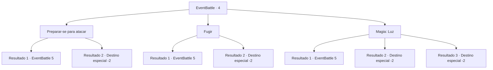

# Eventos de combate · 4

[Índice da tabela](index.md) · [Índice geral](../index.md)

ID: `pt:EventBattle:4` · Fonte: `EventBattle4` · Versão: 1.2.47.

Mapeamento estático dos arquivos; a disponibilidade e a execução dependem do estado da run.

## Texto do evento

O céu se fecha repentinamente e começa a chover. Você encontra uma caverna por perto e resolve adentrá-la. 

 "UUAAAARRGH!"

 Um grito ensurdecedor atinge seus ouvidos. Aparentemente, você não está sozinho. Você desembainha sua arma e se prepara para lutar. 

 "UUOOOORRGH!"

 O som é ouvido diretamente de cima de você.  Você olha para cima e vê um {0} descendo, com suas presas para fora.

## Dados de entrada

```json
{
  "id": 4,
  "grade": 1,
  "monster": "11",
  "required": "2_2_30"
}
```

## Mapa das escolhas



## Escolhas e resultados

### Escolha 1

Preparar-se para atacar

Requisitos e outros campos da escolha:

```json
{
  "required": ""
}
```

#### Resultado 1.1

 Você segue o {0} com seus olhos, com sua arma pronta. Ele circunda você, indo para a esquerda e para a direita, antes de voar em sua direção.

Continuação registrada: [Evento 5](0005.md) na mesma tabela.

```json
{
  "required": "",
  "chance": "7",
  "nextEvent": 5,
  "type": 1,
  "reward": "6_1_0",
  "place": 6
}
```

#### Resultado 1.2

 Você segue o {0} com seus olhos, com sua arma pronta. Ele circunda você, indo para a esquerda e para a direita, antes de voar em sua direção.

Continuação registrada: [Destino especial `-2`](../destinos-especiais.md).

```json
{
  "required": "",
  "chance": "1|0_12_1",
  "nextEvent": -2,
  "type": 0,
  "reward": "0_2_1"
}
```

### Escolha 2

Fugir

Requisitos e outros campos da escolha:

```json
{
  "required": ""
}
```

#### Resultado 2.1

  Você balança sua arma com força.  Ele recua, vacilando um pouco.  Você tenta correr.  Mas você não consegue ir muito longe.

Continuação registrada: [Evento 5](0005.md) na mesma tabela.

```json
{
  "required": "",
  "chance": "12",
  "nextEvent": 5,
  "type": 1,
  "reward": "6_1_0",
  "place": 6
}
```

#### Resultado 2.2

 Você balança sua arma. Ele recua, vacilando um pouco. Você vê uma chance e foge o mais rápido que pode.

Continuação registrada: [Destino especial `-2`](../destinos-especiais.md).

```json
{
  "required": "",
  "chance": "1|0_6_1",
  "nextEvent": -2,
  "type": 0,
  "reward": "0_2_1"
}
```

### Escolha 3

Magia: Luz

Requisitos e outros campos da escolha:

```json
{
  "required": "20_0_1"
}
```

#### Resultado 3.1

 Você tenta lançar um feitiço de relâmpago, mas, devido a pressa, você o pronuncia errado. O {0} percebe seu erro e vem voando em sua direção.

Continuação registrada: [Evento 5](0005.md) na mesma tabela.

```json
{
  "required": "",
  "chance": "18",
  "nextEvent": 5,
  "type": 1,
  "reward": "6_1_0",
  "place": 6
}
```

#### Resultado 3.2

Você conjura um feitiço de relâmpago e o {0} foge da claridade.

Continuação registrada: [Destino especial `-2`](../destinos-especiais.md).

```json
{
  "required": "",
  "chance": "1|0_7_1",
  "nextEvent": -2,
  "type": 0,
  "reward": "0_2_1"
}
```

#### Resultado 3.3

Você conjura um feitiço de relâmpago e o {0} foge da claridade.

Continuação registrada: [Destino especial `-2`](../destinos-especiais.md).

```json
{
  "required": "",
  "chance": "1|0_12_1",
  "nextEvent": -2,
  "type": 0,
  "reward": "0_2_1"
}
```

## Referências que chegam a este evento

Nenhum `nextEvent` positivo da mesma tabela aponta para este nó. Isso não prova que seja inacessível: sorteio e estado de história podem selecioná-lo.

