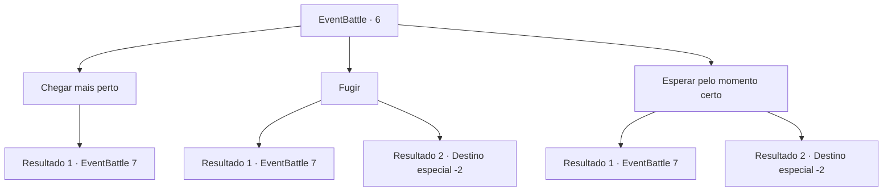

# Eventos de combate · 6

[Índice da tabela](index.md) · [Índice geral](../index.md)

ID: `pt:EventBattle:6` · Fonte: `EventBattle4` · Versão: 1.2.47.

Mapeamento estático dos arquivos; a disponibilidade e a execução dependem do estado da run.

## Texto do evento

|drawing_desert| Você caminha pelo do deserto durante horas a fio. O solo está rachado pelo calor e a luz do sol queima sua pele. Já quase não há água. Então você vê algo longe se movendo.

## Dados de entrada

```json
{
  "id": 6,
  "grade": 1,
  "monster": "4",
  "required": "2_2_30"
}
```

## Mapa das escolhas



## Escolhas e resultados

### Escolha 1

Chegar mais perto

Requisitos e outros campos da escolha:

```json
{
  "required": ""
}
```

#### Resultado 1.1

É uma grande duna de areia em movimento. Ela se aproxima de você rapidamente e um {0} emerge do chão.

Continuação registrada: [Evento 7](0007.md) na mesma tabela.

```json
{
  "required": "",
  "chance": "1",
  "nextEvent": 7,
  "type": 2,
  "reward": "6_1_0",
  "place": 5
}
```

### Escolha 2

Fugir

Requisitos e outros campos da escolha:

```json
{
  "required": ""
}
```

#### Resultado 2.1

 Você tenta correr. Mas seus pés continuam afundando na areia. A criatura vem até você com uma velocidade alarmante. Ele emerge do chão perto de você.

Continuação registrada: [Evento 7](0007.md) na mesma tabela.

```json
{
  "required": "",
  "chance": "15",
  "nextEvent": 7,
  "type": 1,
  "reward": "6_1_0",
  "place": 5
}
```

#### Resultado 2.2

  Você escapa da criatura de areia usando seus reflexos rápidos.

Continuação registrada: [Destino especial `-2`](../destinos-especiais.md).

```json
{
  "required": "",
  "chance": "1|0_6_1",
  "nextEvent": -2,
  "type": 0,
  "reward": ""
}
```

### Escolha 3

Esperar pelo momento certo

Requisitos e outros campos da escolha:

```json
{
  "required": "1_6_9"
}
```

#### Resultado 3.1

  Você espera que a criatura emerja da areia.  Você golpeia, mas erra.  {0} vem até você com uma nuvem de areia atrás dela.

Continuação registrada: [Evento 7](0007.md) na mesma tabela.

```json
{
  "required": "",
  "chance": "11",
  "nextEvent": 7,
  "type": 1,
  "reward": "6_1_0",
  "place": 5
}
```

#### Resultado 3.2

Você espera que a criatura emerja da areia e então a golpeia. 

Continuação registrada: [Destino especial `-2`](../destinos-especiais.md).

```json
{
  "required": "",
  "chance": "1|0_7_1",
  "nextEvent": -2,
  "type": 0,
  "reward": "0_2_2|0_4_9"
}
```

## Referências que chegam a este evento

Nenhum `nextEvent` positivo da mesma tabela aponta para este nó. Isso não prova que seja inacessível: sorteio e estado de história podem selecioná-lo.

