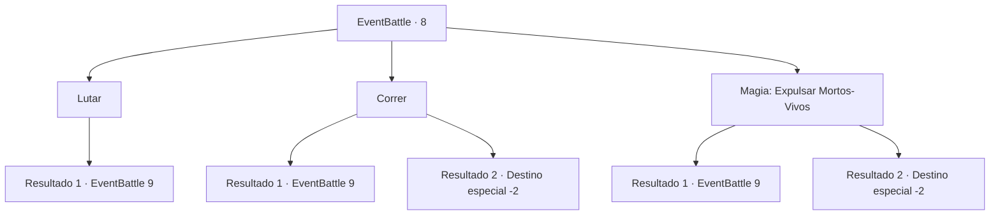

# Eventos de combate · 8

[Índice da tabela](index.md) · [Índice geral](../index.md)

ID: `pt:EventBattle:8` · Fonte: `EventBattle4` · Versão: 1.2.47.

Mapeamento estático dos arquivos; a disponibilidade e a execução dependem do estado da run.

## Texto do evento

|drawing_destroyedGrave| Você encontra uma sepultura no meio da floresta. Alguém a desenterrou. Você começa a investigá-la, quando sente um arrepio a descer pela espinha. De repente, um {0} materializa-se do ar rarefeito à sua frente.

## Dados de entrada

```json
{
  "id": 8,
  "grade": 1,
  "monster": "12_1_30|14_0_20",
  "required": ""
}
```

## Mapa das escolhas



## Escolhas e resultados

### Escolha 1

Lutar

Requisitos e outros campos da escolha:

```json
{
  "required": ""
}
```

#### Resultado 1.1

Você se assusta, mas se recompõe e pega sua arma.

Continuação registrada: [Evento 9](0009.md) na mesma tabela.

```json
{
  "required": "",
  "chance": "1",
  "nextEvent": 9,
  "type": 2,
  "reward": "6_1_0",
  "place": 1
}
```

### Escolha 2

Correr

Requisitos e outros campos da escolha:

```json
{
  "required": ""
}
```

#### Resultado 2.1

Você corre o mais rápido que consegue, mas a criatura simplesmente reaparece em sua frente.

Continuação registrada: [Evento 9](0009.md) na mesma tabela.

```json
{
  "required": "",
  "chance": "10",
  "nextEvent": 9,
  "type": 1,
  "reward": "6_1_0",
  "place": 1
}
```

#### Resultado 2.2

Você foge o mais rápido possível.

Continuação registrada: [Destino especial `-2`](../destinos-especiais.md).

```json
{
  "required": "",
  "chance": "1|0_6_1",
  "nextEvent": -2,
  "type": 0,
  "reward": ""
}
```

### Escolha 3

Magia: Expulsar Mortos-Vivos

Requisitos e outros campos da escolha:

```json
{
  "required": "20_0_1|20_3_1"
}
```

#### Resultado 3.1

Você tenta expulsar o Morto-Vivo, mas falha na pronúncia do feitiço, provavelmente por estar nervoso.

Continuação registrada: [Evento 9](0009.md) na mesma tabela.

```json
{
  "required": "",
  "chance": "8",
  "nextEvent": 9,
  "type": 1,
  "reward": "6_1_0",
  "place": 1
}
```

#### Resultado 3.2

Você conjura Repelir Mortos-vivos e envia {0} de volta ao submundo.

Continuação registrada: [Destino especial `-2`](../destinos-especiais.md).

```json
{
  "required": "",
  "chance": "1|0_14_1",
  "nextEvent": -2,
  "type": 0,
  "reward": "0_2_1"
}
```

## Referências que chegam a este evento

Nenhum `nextEvent` positivo da mesma tabela aponta para este nó. Isso não prova que seja inacessível: sorteio e estado de história podem selecioná-lo.

