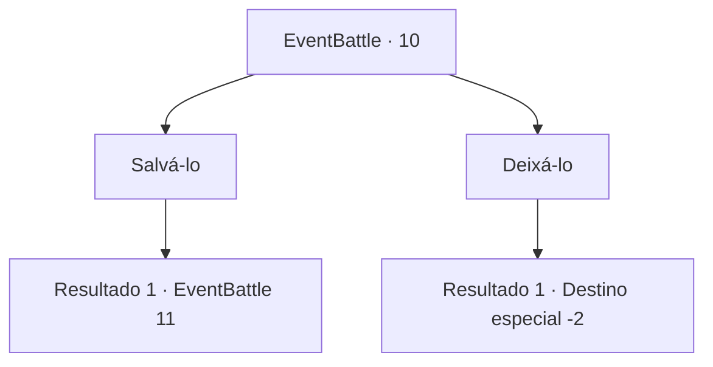

# Eventos de combate · 10

[Índice da tabela](index.md) · [Índice geral](../index.md)

ID: `pt:EventBattle:10` · Fonte: `EventBattle4` · Versão: 1.2.47.

Mapeamento estático dos arquivos; a disponibilidade e a execução dependem do estado da run.

## Texto do evento

  Você ouve alguém gritar por perto.  Você se dirige por alguns arbustos em direção ao som.  Você chega e vê um {0} engolindo um herbalista.  Ele te vê e grita em pânico 

 "AAHHHHH!!! Aventureiro!! Por favor, me ajuda!!!"


## Dados de entrada

```json
{
  "id": 10,
  "grade": 1,
  "monster": "0_1_20|20_0_20",
  "required": "5_235_0"
}
```

## Mapa das escolhas



## Escolhas e resultados

### Escolha 1

Salvá-lo

Requisitos e outros campos da escolha:

```json
{
  "required": ""
}
```

#### Resultado 1.1

Você ataca o {0}, que sacode e cospe o herbalista. Então ele avança contra você. O herbalista agradece rapidamente e depois sai correndo.

Continuação registrada: [Evento 11](0011.md) na mesma tabela.

```json
{
  "required": "",
  "chance": "1",
  "nextEvent": 11,
  "type": 2,
  "reward": "6_1_0",
  "place": 1
}
```

### Escolha 2

Deixá-lo

Requisitos e outros campos da escolha:

```json
{
  "required": ""
}
```

#### Resultado 2.1

Você se afasta do herbalista enquanto ele se desintegra lentamente. Os gritos somem depois de um tempo.

Continuação registrada: [Destino especial `-2`](../destinos-especiais.md).

```json
{
  "required": "",
  "chance": "1",
  "nextEvent": -2,
  "type": 2,
  "reward": "0_3_-1|5_235_9"
}
```

## Referências que chegam a este evento

Nenhum `nextEvent` positivo da mesma tabela aponta para este nó. Isso não prova que seja inacessível: sorteio e estado de história podem selecioná-lo.

