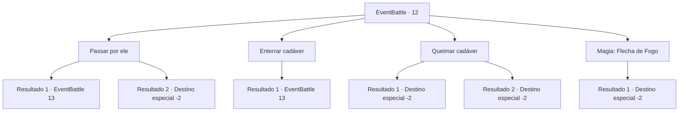

# Eventos de combate · 12

[Índice da tabela](index.md) · [Índice geral](../index.md)

ID: `pt:EventBattle:12` · Fonte: `EventBattle4` · Versão: 1.2.47.

Mapeamento estático dos arquivos; a disponibilidade e a execução dependem do estado da run.

## Texto do evento

 |drawing_deadmanCage|Você encontra uma cela de metal enterrada pela metade na lama. Dentro está um cadáver seco. Você se sente fraco devido ao fedor podre.

## Dados de entrada

```json
{
  "id": 12,
  "grade": 1,
  "monster": "14",
  "required": "1_2_20"
}
```

## Mapa das escolhas



## Escolhas e resultados

### Escolha 1

Passar por ele

Requisitos e outros campos da escolha:

```json
{
  "required": ""
}
```

#### Resultado 1.1

Você tenta ignorá-lo, mas é tarde demais. Um {0} surge na sua frente

Continuação registrada: [Evento 13](0013.md) na mesma tabela.

```json
{
  "required": "",
  "chance": "8",
  "nextEvent": 13,
  "type": 1,
  "reward": "6_1_0",
  "place": 14
}
```

#### Resultado 1.2

Você corre o máximo possível e sai de lá. O fedor parece impregnar no seu nariz.

Continuação registrada: [Destino especial `-2`](../destinos-especiais.md).

```json
{
  "required": "",
  "chance": "1|0_6_1",
  "nextEvent": -2,
  "type": 0,
  "reward": ""
}
```

### Escolha 2

Enterrar cadáver

Requisitos e outros campos da escolha:

```json
{
  "required": ""
}
```

#### Resultado 2.1

Você se aproxima para enterrar o cadáver. Mas o fantasma de seu dono parece te considerar um inimigo. O {0} vem até você, com um grito aterrorizante.

Continuação registrada: [Evento 13](0013.md) na mesma tabela.

```json
{
  "required": "",
  "chance": "1",
  "nextEvent": 13,
  "type": 2,
  "reward": "6_1_0",
  "place": 14
}
```

### Escolha 3

Queimar cadáver

Requisitos e outros campos da escolha:

```json
{
  "required": "8_42_1"
}
```

#### Resultado 3.1

Você acende sua lanterna e joga no cadáver. Ele grita enquanto queima. Você está chocado por ele ainda estar vivo.

Continuação registrada: [Destino especial `-2`](../destinos-especiais.md).

```json
{
  "required": "",
  "chance": "7",
  "nextEvent": -2,
  "type": 2,
  "reward": "0_1_-1|4_42_1"
}
```

#### Resultado 3.2

Você acende sua lanterna e joga no cadáver. Ele grita enquanto queima. Você sai rapidamente do local.

Continuação registrada: [Destino especial `-2`](../destinos-especiais.md).

```json
{
  "required": "",
  "chance": "1|0_14_1",
  "nextEvent": -2,
  "type": 2,
  "reward": "4_42_1|0_2_1|0_3_1"
}
```

### Escolha 4

Magia: Flecha de Fogo

Requisitos e outros campos da escolha:

```json
{
  "required": "20_0_1"
}
```

#### Resultado 4.1

Você pensa em um feitiço simples para cremar o corpo. Você produz uma flecha de fogo da ponta de sua mão e a arremessa na direção do morto. O cadáver grita enquanto queima e você sai rapidamente do local.

Continuação registrada: [Destino especial `-2`](../destinos-especiais.md).

```json
{
  "required": "",
  "chance": "1",
  "nextEvent": -2,
  "type": 2,
  "reward": "0_2_1|0_3_1"
}
```

## Referências que chegam a este evento

Nenhum `nextEvent` positivo da mesma tabela aponta para este nó. Isso não prova que seja inacessível: sorteio e estado de história podem selecioná-lo.

