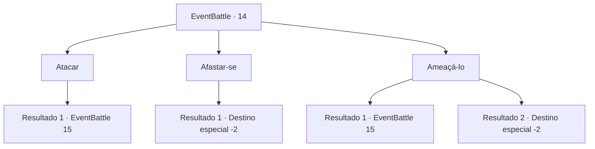

# Eventos de combate · 14

[Índice da tabela](index.md) · [Índice geral](../index.md)

ID: `pt:EventBattle:14` · Fonte: `EventBattle4` · Versão: 1.2.47.

Mapeamento estático dos arquivos; a disponibilidade e a execução dependem do estado da run.

## Texto do evento

|drawing_pond|Você encontra um pequeno lago na floresta. Um cervo está bebendo nele. Conforme você se aproxima do lago, o cervo olha para cima e foge. Mas um {0} de repente emerge do solo e o agarra. O {0} enfia os dentes no pescoço do cervo e olha diretamente para você.

## Dados de entrada

```json
{
  "id": 14,
  "grade": 1,
  "monster": "5|63",
  "required": "1_2_10|2_2_50"
}
```

## Mapa das escolhas



## Escolhas e resultados

### Escolha 1

Atacar

Requisitos e outros campos da escolha:

```json
{
  "required": ""
}
```

#### Resultado 1.1

Você avança até {0} e ataca. O monstro joga o cervo e avança em sua direção.

Continuação registrada: [Evento 15](0015.md) na mesma tabela.

```json
{
  "required": "",
  "chance": "1",
  "nextEvent": 15,
  "type": 2,
  "reward": "6_1_0",
  "place": 1
}
```

### Escolha 2

Afastar-se

Requisitos e outros campos da escolha:

```json
{
  "required": ""
}
```

#### Resultado 2.1

Você se afasta silenciosamente, para não interromper sua refeição.

Continuação registrada: [Destino especial `-2`](../destinos-especiais.md).

```json
{
  "required": "",
  "chance": "1",
  "nextEvent": -2,
  "type": 2,
  "reward": ""
}
```

### Escolha 3

Ameaçá-lo

Requisitos e outros campos da escolha:

```json
{
  "required": ""
}
```

#### Resultado 3.1

Você ameaça o {0}, olhando para ele ameaçadoramente. A criatura não gosta nem um pouco. Ele joga o cervo no chão e avança.

Continuação registrada: [Evento 15](0015.md) na mesma tabela.

```json
{
  "required": "",
  "chance": "9",
  "nextEvent": 15,
  "type": 1,
  "reward": "6_1_0",
  "place": 1
}
```

#### Resultado 3.2

Você ameaça o {0}, olhando para ele ameaçadoramente. A criatura joga fora o cervo e foge.

Continuação registrada: [Destino especial `-2`](../destinos-especiais.md).

```json
{
  "required": "",
  "chance": "1|0_12_1",
  "nextEvent": -2,
  "type": 0,
  "reward": "0_2_1|0_4_10"
}
```

## Referências que chegam a este evento

Nenhum `nextEvent` positivo da mesma tabela aponta para este nó. Isso não prova que seja inacessível: sorteio e estado de história podem selecioná-lo.

