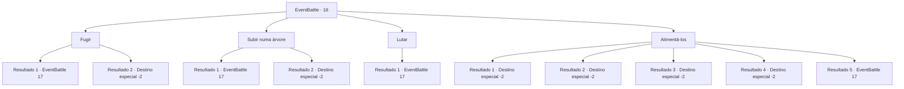

# Eventos de combate · 16

[Índice da tabela](index.md) · [Índice geral](../index.md)

ID: `pt:EventBattle:16` · Fonte: `EventBattle4` · Versão: 1.2.47.

Mapeamento estático dos arquivos; a disponibilidade e a execução dependem do estado da run.

## Texto do evento

 A lua cheia ilumina o céu noturno. Você acabou de acender uma fogueira e está prestes a dormir. |drawing_wolf|Nesse momento, um {0} desce da colina. Ele uiva, e logo, uma alcateia inteira surge.

## Dados de entrada

```json
{
  "id": 16,
  "grade": 1,
  "monster": "3|88_0_20",
  "required": "2_2_50"
}
```

## Mapa das escolhas



## Escolhas e resultados

### Escolha 1

Fugir

Requisitos e outros campos da escolha:

```json
{
  "required": ""
}
```

#### Resultado 1.1

Você abandona o acampamento e corre, mas eles o alcançam eventualmente.

Continuação registrada: [Evento 17](0017.md) na mesma tabela.

```json
{
  "required": "",
  "chance": "14",
  "nextEvent": 17,
  "type": 1,
  "reward": "6_1_0",
  "place": 14
}
```

#### Resultado 1.2

Você abandona o acampamento e corre.

Continuação registrada: [Destino especial `-2`](../destinos-especiais.md).

```json
{
  "required": "",
  "chance": "1|0_6_1",
  "nextEvent": -2,
  "type": 0,
  "reward": ""
}
```

### Escolha 2

Subir numa árvore

Requisitos e outros campos da escolha:

```json
{
  "required": ""
}
```

#### Resultado 2.1

Você tenta subir na árvore atrás da barraca, mas escorrega e cai no chão. Os {0}s cercaram você rapidamente.

Continuação registrada: [Evento 17](0017.md) na mesma tabela.

```json
{
  "required": "",
  "chance": "12",
  "nextEvent": 17,
  "type": 1,
  "reward": "0_0_-1|6_1_0",
  "place": 14
}
```

#### Resultado 2.2

Você sobe rapidamente na árvore atrás da barraca. Os {0}s relutantemente desistem e vão embora.

Continuação registrada: [Destino especial `-2`](../destinos-especiais.md).

```json
{
  "required": "",
  "chance": "1|0_5_1",
  "nextEvent": -2,
  "type": 0,
  "reward": "0_2_1"
}
```

### Escolha 3

Lutar

Requisitos e outros campos da escolha:

```json
{
  "required": ""
}
```

#### Resultado 3.1

Você saca sua arma e os enfrenta.

Continuação registrada: [Evento 17](0017.md) na mesma tabela.

```json
{
  "required": "",
  "chance": "1",
  "nextEvent": 17,
  "type": 2,
  "reward": "6_1_0",
  "place": 14
}
```

### Escolha 4

Alimentá-los

Requisitos e outros campos da escolha:

```json
{
  "required": ""
}
```

#### Resultado 4.1

Você pega um peixe e joga no {0}. O {0} fica distraído e você sai correndo.

Continuação registrada: [Destino especial `-2`](../destinos-especiais.md).

```json
{
  "required": "8_124_1",
  "chance": "1",
  "nextEvent": -2,
  "type": 2,
  "reward": "4_124_1|0_2_1"
}
```

#### Resultado 4.2

Você pega um peixe e joga no {0}. O {0} fica distraído e você sai correndo.

Continuação registrada: [Destino especial `-2`](../destinos-especiais.md).

```json
{
  "required": "8_125_1",
  "chance": "1",
  "nextEvent": -2,
  "type": 2,
  "reward": "4_125_1|0_2_1"
}
```

#### Resultado 4.3

Você pega um peixe e joga no {0}. O {0} fica distraído e você sai correndo.

Continuação registrada: [Destino especial `-2`](../destinos-especiais.md).

```json
{
  "required": "8_143_1",
  "chance": "1",
  "nextEvent": -2,
  "type": 2,
  "reward": "4_143_1|0_2_1"
}
```

#### Resultado 4.4

Você pega um peixe e joga no {0}. O {0} fica distraído e você sai correndo.

Continuação registrada: [Destino especial `-2`](../destinos-especiais.md).

```json
{
  "required": "8_144_1",
  "chance": "1",
  "nextEvent": -2,
  "type": 2,
  "reward": "4_144_1|0_2_1"
}
```

#### Resultado 4.5

Você vasculha sua mochila, mas não consegue encontrar nada para oferecer. Eles exibem os dentes e avançam até você.

Continuação registrada: [Evento 17](0017.md) na mesma tabela.

```json
{
  "required": "10_124_1|10_125_1|10_143_1|10_144_1",
  "chance": "1",
  "nextEvent": 17,
  "type": 2,
  "reward": "6_1_0",
  "place": 14
}
```

## Referências que chegam a este evento

Nenhum `nextEvent` positivo da mesma tabela aponta para este nó. Isso não prova que seja inacessível: sorteio e estado de história podem selecioná-lo.

