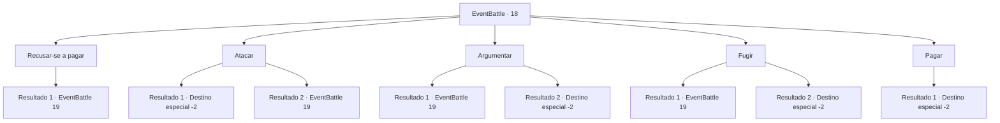

# Eventos de combate · 18

[Índice da tabela](index.md) · [Índice geral](../index.md)

ID: `pt:EventBattle:18` · Fonte: `EventBattle4` · Versão: 1.2.47.

Mapeamento estático dos arquivos; a disponibilidade e a execução dependem do estado da run.

## Texto do evento

  Um grupo de {0}s vêm até você à cavalo.  Eles bloqueiam seu caminho e dizem. 

 "Para passar por aqui, tem que pagar um pedágio pra seguir em segurança, se não vai arrumar problema"


## Dados de entrada

```json
{
  "id": 18,
  "grade": 1,
  "monster": "2",
  "required": "2_2_40"
}
```

## Mapa das escolhas



## Escolhas e resultados

### Escolha 1

Recusar-se a pagar

Requisitos e outros campos da escolha:

```json
{
  "required": ""
}
```

#### Resultado 1.1

Você pede que eles se afastem. Eles descem de seus cavalos e desembainham suas espadas.

Continuação registrada: [Evento 19](0019.md) na mesma tabela.

```json
{
  "required": "",
  "chance": "1",
  "nextEvent": 19,
  "type": 2,
  "reward": "6_1_0",
  "place": 1
}
```

### Escolha 2

Atacar

Requisitos e outros campos da escolha:

```json
{
  "required": ""
}
```

#### Resultado 2.1

Você acerta um de seus cavalos no pescoço, o mais forte possível. O cavalo assustado derruba o {0} e o pisoteia. Os outros fogem, amedrontados.

Continuação registrada: [Destino especial `-2`](../destinos-especiais.md).

```json
{
  "required": "",
  "chance": "1|0_5_1",
  "nextEvent": -2,
  "type": 0,
  "reward": "0_2_1|0_4_3"
}
```

#### Resultado 2.2

Você acertou o pescoço de um dos cavalos com toda sua força. O cavalo fica surpreso, mas nada ocorre. Eles descem dos cavalos e se aproximam de você.

Continuação registrada: [Evento 19](0019.md) na mesma tabela.

```json
{
  "required": "",
  "chance": "7",
  "nextEvent": 19,
  "type": 1,
  "reward": "6_1_0",
  "place": 1
}
```

### Escolha 3

Argumentar 

Requisitos e outros campos da escolha:

```json
{
  "required": "1_7_10"
}
```

#### Resultado 3.1

Você pede que eles se afastem. Nenhum deles ouve. 

 "Tudo bem, se você quiser fazer isso da maneira mais difícil... Nós tiraremos isso de você."

 Eles descem dos cavalos e desembainham as espadas.

Continuação registrada: [Evento 19](0019.md) na mesma tabela.

```json
{
  "required": "",
  "chance": "12",
  "nextEvent": 19,
  "type": 1,
  "reward": "6_1_0",
  "place": 1
}
```

#### Resultado 3.2

Você pede que eles se afastem. Eles são persuadidos por sua boa aparência e labia, e deixam você ir.

Continuação registrada: [Destino especial `-2`](../destinos-especiais.md).

```json
{
  "required": "",
  "chance": "1|0_7_1",
  "nextEvent": -2,
  "type": 0,
  "reward": "0_2_1"
}
```

### Escolha 4

Fugir

Requisitos e outros campos da escolha:

```json
{
  "required": ""
}
```

#### Resultado 4.1

Você tenta correr, mas eles são muito mais rápidos a cavalo. Eles xingam e avançam até você.

Continuação registrada: [Evento 19](0019.md) na mesma tabela.

```json
{
  "required": "",
  "chance": "17",
  "nextEvent": 19,
  "type": 1,
  "reward": "6_1_0",
  "place": 1
}
```

#### Resultado 4.2

Você consegue fugir graças aos seus reflexos impressionantes.

Continuação registrada: [Destino especial `-2`](../destinos-especiais.md).

```json
{
  "required": "",
  "chance": "1|0_6_1",
  "nextEvent": -2,
  "type": 0,
  "reward": ""
}
```

### Escolha 5

Pagar

Requisitos e outros campos da escolha:

```json
{
  "required": "1_4_10"
}
```

#### Resultado 5.1

Você paga os {0}s para deixá-lo passar. Você avança, sem ter que lutar.

Continuação registrada: [Destino especial `-2`](../destinos-especiais.md).

```json
{
  "required": "",
  "chance": "1",
  "nextEvent": -2,
  "type": 2,
  "reward": "0_4_-10|0_2_1"
}
```

## Referências que chegam a este evento

Nenhum `nextEvent` positivo da mesma tabela aponta para este nó. Isso não prova que seja inacessível: sorteio e estado de história podem selecioná-lo.

