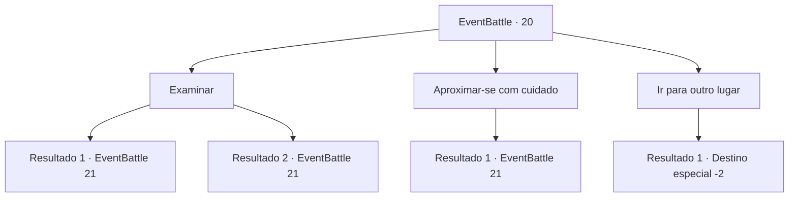

# Eventos de combate · 20

[Índice da tabela](index.md) · [Índice geral](../index.md)

ID: `pt:EventBattle:20` · Fonte: `EventBattle4` · Versão: 1.2.47.

Mapeamento estático dos arquivos; a disponibilidade e a execução dependem do estado da run.

## Texto do evento

Você encontra uma carruagem quebrada, ligeiramente fora da estrada. Está danificada, mas a carga está bem embalada e intacta.

## Dados de entrada

```json
{
  "id": 20,
  "grade": 1,
  "monster": "1|2|7",
  "required": "2_2_20"
}
```

## Mapa das escolhas



## Escolhas e resultados

### Escolha 1

Examinar

Requisitos e outros campos da escolha:

```json
{
  "required": ""
}
```

#### Resultado 1.1

Você decide procurar na carruagem quebrada por itens que podem ser úteis. Enquanto você vasculha a carga, uma flecha voa em sua direção. De forma bem rápida, você é atingido. 

 "Heee---ha!"

 {0} riem de forma estranha, enquanto pulam dos arbustos.

Continuação registrada: [Evento 21](0021.md) na mesma tabela.

```json
{
  "required": "",
  "chance": "10",
  "nextEvent": 21,
  "type": 1,
  "reward": "0_0_-1|6_1_0",
  "place": 14
}
```

#### Resultado 1.2

Você decide procurar na carruagem quebrada por itens que podem ser úteis.

Continuação registrada: [Evento 21](0021.md) na mesma tabela.

```json
{
  "required": "",
  "chance": "1|0_6_1",
  "nextEvent": 21,
  "type": 0,
  "reward": "6_1_0",
  "place": 14
}
```

### Escolha 2

Aproximar-se com cuidado

Requisitos e outros campos da escolha:

```json
{
  "required": "1_14_12"
}
```

#### Resultado 2.1

Você acha que pode ser algum tipo de armadilha, e aproxima-se devagar e com cuidado. Você vê algo se mover nos arbustos perto da carruagem. Seja lá o que for, ele percebe sua suspeita. Há um momento de tensão, que logo é quebrado por uma flecha que voa em sua direção. Você é capaz de evitá-la porque foi precavido. Logo depois, um grupo de {0}s surgem dos arbustos.

Continuação registrada: [Evento 21](0021.md) na mesma tabela.

```json
{
  "required": "",
  "chance": "1",
  "nextEvent": 21,
  "type": 2,
  "reward": "6_1_0",
  "place": 14
}
```

### Escolha 3

Ir para outro lugar

Requisitos e outros campos da escolha:

```json
{
  "required": ""
}
```

#### Resultado 3.1

Você se afasta da carruagem quebrada.

Continuação registrada: [Destino especial `-2`](../destinos-especiais.md).

```json
{
  "required": "",
  "chance": "1",
  "nextEvent": -2,
  "type": 2,
  "reward": ""
}
```

## Referências que chegam a este evento

Nenhum `nextEvent` positivo da mesma tabela aponta para este nó. Isso não prova que seja inacessível: sorteio e estado de história podem selecioná-lo.

