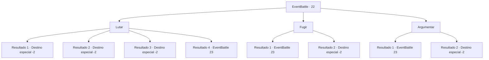

# Eventos de combate · 22

[Índice da tabela](index.md) · [Índice geral](../index.md)

ID: `pt:EventBattle:22` · Fonte: `EventBattle4` · Versão: 1.2.47.

Mapeamento estático dos arquivos; a disponibilidade e a execução dependem do estado da run.

## Texto do evento

|drawing_plain| Você está caminhando por terra acidentada e cheia de cascalho, observando as nuvens de chuva pairando sobre você. Parece que o tempo seco está chegando ao fim. Então você vê uma águia circulando, acima de sua cabeça. Isso te incomoda, mas logo a ave voa para longe e você está sozinho em seu caminho novamente. Alguns momentos depois, você percebe que a águia era treinada. Você enfrenta um grupo de {0} s que o perseguiu pelo caminho.

## Dados de entrada

```json
{
  "id": 22,
  "grade": 1,
  "monster": "10",
  "required": "2_2_50"
}
```

## Mapa das escolhas



## Escolhas e resultados

### Escolha 1

Lutar

Requisitos e outros campos da escolha:

```json
{
  "required": ""
}
```

#### Resultado 1.1

Você tira a 'Grande Espada na Madeira'. Assim que eles a veem, fogem.

Continuação registrada: [Destino especial `-2`](../destinos-especiais.md).

```json
{
  "required": "8_69_1",
  "chance": "1",
  "nextEvent": -2,
  "type": 2,
  "reward": "0_2_1"
}
```

#### Resultado 1.2

Você tira o 'Olho de Papnil'. Que emite um brilho medonho, fazendo-os fugirem assustados.

Continuação registrada: [Destino especial `-2`](../destinos-especiais.md).

```json
{
  "required": "8_98_1",
  "chance": "1",
  "nextEvent": -2,
  "type": 2,
  "reward": "0_2_1"
}
```

#### Resultado 1.3

Você tira o 'Coração Congelado'. Assim que eles o veem, fogem.

Continuação registrada: [Destino especial `-2`](../destinos-especiais.md).

```json
{
  "required": "8_113_1",
  "chance": "1",
  "nextEvent": -2,
  "type": 2,
  "reward": "0_2_1"
}
```

#### Resultado 1.4

Você decide mostrar a eles que não é uma presa fácil.

Continuação registrada: [Evento 23](0023.md) na mesma tabela.

```json
{
  "required": "10_98_1|10_69_1|10_113_1",
  "chance": "1",
  "nextEvent": 23,
  "type": 2,
  "reward": "6_1_0",
  "place": 0
}
```

### Escolha 2

Fugir

Requisitos e outros campos da escolha:

```json
{
  "required": ""
}
```

#### Resultado 2.1

Você se vira e corre. Mas eles logo o alcançam e cercam você.

Continuação registrada: [Evento 23](0023.md) na mesma tabela.

```json
{
  "required": "",
  "chance": "12",
  "nextEvent": 23,
  "type": 1,
  "reward": "6_1_0",
  "place": 0
}
```

#### Resultado 2.2

Você se vira e corre. Eles não conseguem alcançá-lo.

Continuação registrada: [Destino especial `-2`](../destinos-especiais.md).

```json
{
  "required": "",
  "chance": "1|0_6_1",
  "nextEvent": -2,
  "type": 0,
  "reward": ""
}
```

### Escolha 3

Argumentar 

Requisitos e outros campos da escolha:

```json
{
  "required": "1_7_10"
}
```

#### Resultado 3.1

Você tenta argumentar com eles, mas eles preferem a força bruta.

Continuação registrada: [Evento 23](0023.md) na mesma tabela.

```json
{
  "required": "",
  "chance": "17",
  "nextEvent": 23,
  "type": 1,
  "reward": "6_1_0",
  "place": 0
}
```

#### Resultado 3.2

Você se lembra do que leu em um livro chamado 'Compreendendo a Línguagem do Dragão'. Os {0}s falam essa língua, então você assume que eles vão te entender. Você fala com os {0}s na língua Dracônica. Eles imediatamente caem de joelhos e se curvam. 

 "Nos desculpe! Não o reconhecemos, Grande Dragão...!"

 Eles parecem pensar que você é um dragão polimorfo. Eles fogem, deixando seu ouro para trás.

Continuação registrada: [Destino especial `-2`](../destinos-especiais.md).

```json
{
  "required": "",
  "chance": "1|0_7_1",
  "nextEvent": -2,
  "type": 0,
  "reward": "0_2_1|0_4_15"
}
```

## Referências que chegam a este evento

Nenhum `nextEvent` positivo da mesma tabela aponta para este nó. Isso não prova que seja inacessível: sorteio e estado de história podem selecioná-lo.

