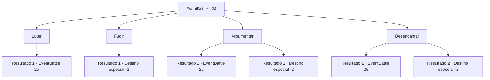

# Eventos de combate · 24

[Índice da tabela](index.md) · [Índice geral](../index.md)

ID: `pt:EventBattle:24` · Fonte: `EventBattle4` · Versão: 1.2.47.

Mapeamento estático dos arquivos; a disponibilidade e a execução dependem do estado da run.

## Texto do evento

Você está caminhando pela floresta quando tropeça em uma cachoeira. Seus pés e joelhos estão doloridos, então você se senta em uma grande pedra para fazer uma pausa. A rocha em que você se apoia começa a tremer e se levantar.

## Dados de entrada

```json
{
  "id": 24,
  "grade": 1,
  "monster": "15",
  "required": "1_2_35|2_2_80"
}
```

## Mapa das escolhas



## Escolhas e resultados

### Escolha 1

Lutar

Requisitos e outros campos da escolha:

```json
{
  "required": ""
}
```

#### Resultado 1.1

Você saca sua arma e se prepara para a batalha. O {0} balança seu punho enorme em sua direção.

Continuação registrada: [Evento 25](0025.md) na mesma tabela.

```json
{
  "required": "",
  "chance": "1",
  "nextEvent": 25,
  "type": 2,
  "reward": "6_1_0",
  "place": 1
}
```

### Escolha 2

Fugir

Requisitos e outros campos da escolha:

```json
{
  "required": ""
}
```

#### Resultado 2.1

Você corre do {0}. Ele o encara, mas não te persegue.

Continuação registrada: [Destino especial `-2`](../destinos-especiais.md).

```json
{
  "required": "",
  "chance": "1",
  "nextEvent": -2,
  "type": 2,
  "reward": ""
}
```

### Escolha 3

Argumentar

Requisitos e outros campos da escolha:

```json
{
  "required": "1_7_10"
}
```

#### Resultado 3.1

Você não consegue raciocinar com isso. O {0} balança seu punho enorme em sua direção.

Continuação registrada: [Evento 25](0025.md) na mesma tabela.

```json
{
  "required": "",
  "chance": "9",
  "nextEvent": 25,
  "type": 1,
  "reward": "6_1_0",
  "place": 1
}
```

#### Resultado 3.2

Você convence os {0} com seu charme carismático. Ele volta a dormir e você descansa nas costas dele.

Continuação registrada: [Destino especial `-2`](../destinos-especiais.md).

```json
{
  "required": "",
  "chance": "1|0_12_1",
  "nextEvent": -2,
  "type": 0,
  "reward": "0_0_1|0_1_1|0_2_1"
}
```

### Escolha 4

Desencantar

Requisitos e outros campos da escolha:

```json
{
  "required": "1_7_10|20_0_1"
}
```

#### Resultado 4.1

Você tenta conjurar o feitiço para mover o {0}, mas falha. O {0} balança seu punho enorme em sua direção.

Continuação registrada: [Evento 25](0025.md) na mesma tabela.

```json
{
  "required": "",
  "chance": "12",
  "nextEvent": 25,
  "type": 1,
  "reward": "6_1_0",
  "place": 1
}
```

#### Resultado 4.2

Você conjura o feitiço que move o {0}. O {0} para e se desfaz em pedaços. Você senta no topo da pilha de {0} e faz uma pausa.

Continuação registrada: [Destino especial `-2`](../destinos-especiais.md).

```json
{
  "required": "",
  "chance": "1|0_7_1",
  "nextEvent": -2,
  "type": 0,
  "reward": "0_0_1|0_1_1|0_2_1|0_4_60"
}
```

## Referências que chegam a este evento

Nenhum `nextEvent` positivo da mesma tabela aponta para este nó. Isso não prova que seja inacessível: sorteio e estado de história podem selecioná-lo.

