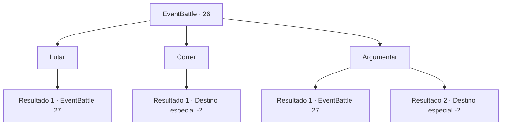

# Eventos de combate · 26

[Índice da tabela](index.md) · [Índice geral](../index.md)

ID: `pt:EventBattle:26` · Fonte: `EventBattle4` · Versão: 1.2.47.

Mapeamento estático dos arquivos; a disponibilidade e a execução dependem do estado da run.

## Texto do evento

Você está passando por uma área de gêiseres fumegantes. Você olha para o chão abaixo de seus pés, que brilha em vermelho intenso, e o sente rugir ameaçadoramente de vez em quando. Assim que você pressente que algo ruim possa acontecer, o solo à sua frente desaba. Um {0} emerge das rachaduras. Ele olha para você e ordena que saia já dali.

## Dados de entrada

```json
{
  "id": 26,
  "grade": 1,
  "monster": "15|16",
  "required": "1_2_80"
}
```

## Mapa das escolhas



## Escolhas e resultados

### Escolha 1

Lutar

Requisitos e outros campos da escolha:

```json
{
  "required": ""
}
```

#### Resultado 1.1

Você se prepara para lutar. O {0} olha para você e zomba.

Continuação registrada: [Evento 27](0027.md) na mesma tabela.

```json
{
  "required": "",
  "chance": "1",
  "nextEvent": 27,
  "type": 2,
  "reward": "6_1_0",
  "place": 2
}
```

### Escolha 2

Correr

Requisitos e outros campos da escolha:

```json
{
  "required": ""
}
```

#### Resultado 2.1

Você fugiu do {0}. Ele parecia zombar de você pelas costas.

Continuação registrada: [Destino especial `-2`](../destinos-especiais.md).

```json
{
  "required": "",
  "chance": "1",
  "nextEvent": -2,
  "type": 2,
  "reward": ""
}
```

### Escolha 3

Argumentar

Requisitos e outros campos da escolha:

```json
{
  "required": "1_7_10"
}
```

#### Resultado 3.1

Você pede educadamente para passar, Mas o {0} zomba e te ataca.

Continuação registrada: [Evento 27](0027.md) na mesma tabela.

```json
{
  "required": "",
  "chance": "20",
  "nextEvent": 27,
  "type": 1,
  "reward": "6_1_0",
  "place": 2
}
```

#### Resultado 3.2

Você diz de forma persuasiva para o {0} que você está simplesmente passando. O {0} ouve e acena com a cabeça. 

 "Passe silenciosamente, eu não quero ouvir mais nem um piu."


Continuação registrada: [Destino especial `-2`](../destinos-especiais.md).

```json
{
  "required": "",
  "chance": "1|0_12_1",
  "nextEvent": -2,
  "type": 0,
  "reward": "0_2_1"
}
```

## Referências que chegam a este evento

Nenhum `nextEvent` positivo da mesma tabela aponta para este nó. Isso não prova que seja inacessível: sorteio e estado de história podem selecioná-lo.

