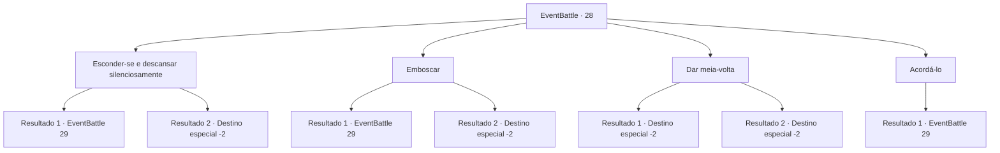

# Eventos de combate · 28

[Índice da tabela](index.md) · [Índice geral](../index.md)

ID: `pt:EventBattle:28` · Fonte: `EventBattle4` · Versão: 1.2.47.

Mapeamento estático dos arquivos; a disponibilidade e a execução dependem do estado da run.

## Texto do evento

|drawing_blizzard|O céu escurece em um instante, e uma nevasca mais densa chega. Você para de caminhar e olha ao redor da montanha nevada, tremendo de frio. Felizmente, você encontra uma pequena caverna e entra nela. A sua estrutura parece sugerir que existe outra entrada. Em breve, você encontra um {0} na caverna, dormindo sozinho.

## Dados de entrada

```json
{
  "id": 28,
  "grade": 1,
  "monster": "18|42_0_55|70",
  "required": "1_2_35"
}
```

## Mapa das escolhas



## Escolhas e resultados

### Escolha 1

Esconder-se e descansar silenciosamente

Requisitos e outros campos da escolha:

```json
{
  "required": ""
}
```

#### Resultado 1.1

Você decide esperar a nevasca passar lá fora. Você anda com cuidado, para não acordar o {0}, mas pisa em um gelo fino. O 

 "Crack!"

 envia ecos pela caverna e o {0} acorda e te encontra. Ele vem na sua direção, com os punhos balançando.

Continuação registrada: [Evento 29](0029.md) na mesma tabela.

```json
{
  "required": "",
  "chance": "5",
  "nextEvent": 29,
  "type": 1,
  "reward": "6_1_0",
  "place": 6
}
```

#### Resultado 1.2

Você decide esperar a nevasca passar lá fora. Você anda com cuidado, para não acordar o {0} e, em seguida, chega a um depósito no canto. Você deixa a caverna com segurança depois que a nevasca passa.

Continuação registrada: [Destino especial `-2`](../destinos-especiais.md).

```json
{
  "required": "",
  "chance": "1|0_6_1",
  "nextEvent": -2,
  "type": 0,
  "reward": "0_1_0|0_2_1"
}
```

### Escolha 2

Emboscar

Requisitos e outros campos da escolha:

```json
{
  "required": ""
}
```

#### Resultado 2.1

Você decide matar o dono da caverna. Você anda com cuidado, para não acordar o {0}, mas pisa no gelo fino. O 

 "Crack!"

 envia ecos pela caverna, e o {0} acorda e te encontra. Ele vem na sua direção, com os punhos balançando.

Continuação registrada: [Evento 29](0029.md) na mesma tabela.

```json
{
  "required": "",
  "chance": "15",
  "nextEvent": 29,
  "type": 1,
  "reward": "6_1_0",
  "place": 6
}
```

#### Resultado 2.2

Você decide matar o dono da caverna. Ele está dormindo profundamente, sem perceber que você está se aproximando. Você golpeia seu pescoço com sua arma o mais forte que consegue. Você sente o estalo de sua espinha através do aperto. Ele grita ao tentar se levantar, mas desmaia e morre logo depois. Você sai da caverna com segurança após o fim da nevasca.

Continuação registrada: [Destino especial `-2`](../destinos-especiais.md).

```json
{
  "required": "",
  "chance": "1|0_5_1",
  "nextEvent": -2,
  "type": 0,
  "reward": "0_2_2|0_1_0|0_4_100"
}
```

### Escolha 3

Dar meia-volta

Requisitos e outros campos da escolha:

```json
{
  "required": ""
}
```

#### Resultado 3.1

Você silenciosamente volta para fora. A nevasca entra através de suas roupas e cobre seu corpo. Você fica congelado por andar no frio.

Continuação registrada: [Destino especial `-2`](../destinos-especiais.md).

```json
{
  "required": "",
  "chance": "16",
  "nextEvent": -2,
  "type": 1,
  "reward": "0_0_-1"
}
```

#### Resultado 3.2

Você silenciosamente volta. A nevasca entra em suas roupas e cobre seu corpo. Mas uma nevasca não pode machucá-lo. Você suporta o frio e caminha silenciosamente.

Continuação registrada: [Destino especial `-2`](../destinos-especiais.md).

```json
{
  "required": "",
  "chance": "1|0_13_1",
  "nextEvent": -2,
  "type": 0,
  "reward": ""
}
```

### Escolha 4

Acordá-lo

Requisitos e outros campos da escolha:

```json
{
  "required": ""
}
```

#### Resultado 4.1

Você grita com confiança, para acordar o {0}. Ele acorda, assustado. E Então ruge enquanto avança até você.

Continuação registrada: [Evento 29](0029.md) na mesma tabela.

```json
{
  "required": "",
  "chance": "1",
  "nextEvent": 29,
  "type": 2,
  "reward": "6_1_0",
  "place": 6
}
```

## Referências que chegam a este evento

Nenhum `nextEvent` positivo da mesma tabela aponta para este nó. Isso não prova que seja inacessível: sorteio e estado de história podem selecioná-lo.

