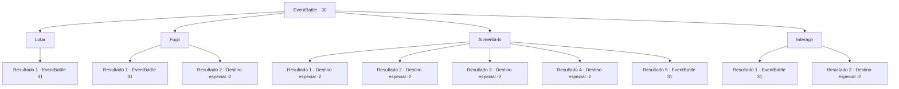

# Eventos de combate · 30

[Índice da tabela](index.md) · [Índice geral](../index.md)

ID: `pt:EventBattle:30` · Fonte: `EventBattle4` · Versão: 1.2.47.

Mapeamento estático dos arquivos; a disponibilidade e a execução dependem do estado da run.

## Texto do evento

Você está caminhando por um bosque de pinheiros altos. Você para para alongar o corpo e olha para o céu límpido e claro. Ao abaixar o olhar, você fica cara a cara com o rosto de um {0}.

## Dados de entrada

```json
{
  "id": 30,
  "grade": 1,
  "monster": "77|27",
  "required": "2_2_50"
}
```

## Mapa das escolhas



## Escolhas e resultados

### Escolha 1

Lutar

Requisitos e outros campos da escolha:

```json
{
  "required": ""
}
```

#### Resultado 1.1

Você cuidadosamente pega sua arma enquanto o olha diretamente nos olhos. O {0} mostra os dentes e rosna antes de atacar você.

Continuação registrada: [Evento 31](0031.md) na mesma tabela.

```json
{
  "required": "",
  "chance": "1",
  "nextEvent": 31,
  "type": 2,
  "reward": "6_1_0",
  "place": 1
}
```

### Escolha 2

Fugir

Requisitos e outros campos da escolha:

```json
{
  "required": ""
}
```

#### Resultado 2.1

Você se vira para correr, mas o {0} morde o seu tornozelo.

Continuação registrada: [Evento 31](0031.md) na mesma tabela.

```json
{
  "required": "",
  "chance": "16",
  "nextEvent": 31,
  "type": 1,
  "reward": "6_1_0|0_0_-1",
  "place": 1
}
```

#### Resultado 2.2

Você se vira para correr. O {0} o persegue por um tempo antes de desistir e se afastar.

Continuação registrada: [Destino especial `-2`](../destinos-especiais.md).

```json
{
  "required": "",
  "chance": "1|0_6_1",
  "nextEvent": -2,
  "type": 0,
  "reward": ""
}
```

### Escolha 3

Alimentá-lo

Requisitos e outros campos da escolha:

```json
{
  "required": ""
}
```

#### Resultado 3.1

Você pega um peixe e joga no {0}. O {0} fica distraído e você sai correndo.

Continuação registrada: [Destino especial `-2`](../destinos-especiais.md).

```json
{
  "required": "8_124_1",
  "chance": "1",
  "nextEvent": -2,
  "type": 2,
  "reward": "4_124_1|0_2_1"
}
```

#### Resultado 3.2

Você pega um peixe e joga no {0}. O {0} fica distraído e você sai correndo.

Continuação registrada: [Destino especial `-2`](../destinos-especiais.md).

```json
{
  "required": "8_125_1",
  "chance": "1",
  "nextEvent": -2,
  "type": 2,
  "reward": "4_125_1|0_2_1"
}
```

#### Resultado 3.3

Você pega um peixe e joga no {0}. O {0} fica distraído e você sai correndo.

Continuação registrada: [Destino especial `-2`](../destinos-especiais.md).

```json
{
  "required": "8_143_1",
  "chance": "1",
  "nextEvent": -2,
  "type": 2,
  "reward": "4_143_1|0_2_1"
}
```

#### Resultado 3.4

Você pega um peixe e joga no {0}. O {0} fica distraído e você sai correndo.

Continuação registrada: [Destino especial `-2`](../destinos-especiais.md).

```json
{
  "required": "8_144_1",
  "chance": "1",
  "nextEvent": -2,
  "type": 2,
  "reward": "4_144_1|0_2_1"
}
```

#### Resultado 3.5

Você vasculha sua mochila, mas não consegue encontrar nada para oferecer a eles. Eles mostram os dentes e atacam você.

Continuação registrada: [Evento 31](0031.md) na mesma tabela.

```json
{
  "required": "10_124_1|10_125_1|10_143_1|10_144_1",
  "chance": "1",
  "nextEvent": 31,
  "type": 2,
  "reward": "6_1_0",
  "place": 1
}
```

### Escolha 4

Interagir 

Requisitos e outros campos da escolha:

```json
{
  "required": ""
}
```

#### Resultado 4.1

Você olha o {0} nos olhos e estende a mão. O {0} morde seu braço.

Continuação registrada: [Evento 31](0031.md) na mesma tabela.

```json
{
  "required": "",
  "chance": "13",
  "nextEvent": 31,
  "type": 1,
  "reward": "6_1_0|0_0_-1",
  "place": 1
}
```

#### Resultado 4.2

Você olha o {0} nos olhos e lentamente estende a mão para acariciá-lo. O {0} parece satisfeito enquanto respira de forma constante. Então ele se vira e se afasta de você.

Continuação registrada: [Destino especial `-2`](../destinos-especiais.md).

```json
{
  "required": "",
  "chance": "1|0_12_1",
  "nextEvent": -2,
  "type": 0,
  "reward": "0_2_1"
}
```

## Referências que chegam a este evento

Nenhum `nextEvent` positivo da mesma tabela aponta para este nó. Isso não prova que seja inacessível: sorteio e estado de história podem selecioná-lo.

