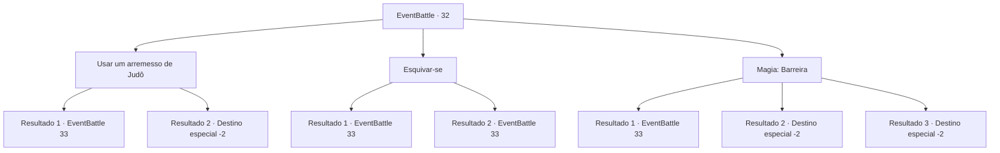

# Eventos de combate · 32

[Índice da tabela](index.md) · [Índice geral](../index.md)

ID: `pt:EventBattle:32` · Fonte: `EventBattle4` · Versão: 1.2.47.

Mapeamento estático dos arquivos; a disponibilidade e a execução dependem do estado da run.

## Texto do evento

Você está caminhando por uma grande planície quando uma sombra gigante paira sobre você. Inicialmente, você pensa que é um dragão, mas olha para cima e descobre que é um {0}. Ele circula acima de você e, em seguida, desce com as garras bem abertas.

## Dados de entrada

```json
{
  "id": 32,
  "grade": 1,
  "monster": "40|53_0_55",
  "required": "1_2_25"
}
```

## Mapa das escolhas



## Escolhas e resultados

### Escolha 1

Usar um arremesso de Judô

Requisitos e outros campos da escolha:

```json
{
  "required": ""
}
```

#### Resultado 1.1

Você agarra no ar o {0} pelo pé, mas o peso e a velocidade do {0} faz você mergulhar direto no chão.

Continuação registrada: [Evento 33](0033.md) na mesma tabela.

```json
{
  "required": "",
  "chance": "18",
  "nextEvent": 33,
  "type": 1,
  "reward": "0_0_-1|6_1_0",
  "place": 0
}
```

#### Resultado 1.2

Você agarra no ar o {0} pelo pé e o joga no chão por cima do seu ombro. O {0} treme por um tempo antes de dar seu último suspiro.

Continuação registrada: [Destino especial `-2`](../destinos-especiais.md).

```json
{
  "required": "",
  "chance": "1|0_5_1",
  "nextEvent": -2,
  "type": 0,
  "reward": "0_2_1|0_4_30"
}
```

### Escolha 2

Esquivar-se

Requisitos e outros campos da escolha:

```json
{
  "required": ""
}
```

#### Resultado 2.1

O {0} é muito rápido e você não consegue evitá-lo. Suas garras cravam profundamente em sua carne.

Continuação registrada: [Evento 33](0033.md) na mesma tabela.

```json
{
  "required": "",
  "chance": "12",
  "nextEvent": 33,
  "type": 1,
  "reward": "0_0_-1|6_1_0",
  "place": 0
}
```

#### Resultado 2.2

Você se esquiva das garras {0} enquanto elas cortam o ar. 

 "Grrrr..."

 O {0} faz um pouso difícil no chão. Então ele grita com você e ataca.

Continuação registrada: [Evento 33](0033.md) na mesma tabela.

```json
{
  "required": "",
  "chance": "1|0_6_1",
  "nextEvent": 33,
  "type": 0,
  "reward": "6_1_0",
  "place": 0
}
```

### Escolha 3

Magia: Barreira

Requisitos e outros campos da escolha:

```json
{
  "required": "20_0_2|1_1_2"
}
```

#### Resultado 3.1

Você tenta formar uma barreira, mas não consegue ser rápido e calmo o suficiente. O peso e a velocidade do {0} fazem você mergulhar direto no chão.

Continuação registrada: [Evento 33](0033.md) na mesma tabela.

```json
{
  "required": "",
  "chance": "14",
  "nextEvent": 33,
  "type": 1,
  "reward": "0_0_-1|6_1_0|0_1_-1",
  "place": 0
}
```

#### Resultado 3.2

Você forma uma barreira e bloqueia o ataque do {0}. Faíscas surgem do confronto, e assustam o {0}, que é repelido.

Continuação registrada: [Destino especial `-2`](../destinos-especiais.md).

```json
{
  "required": "",
  "chance": "1|0_7_1",
  "nextEvent": -2,
  "type": 0,
  "reward": "0_2_2|0_1_-1"
}
```

#### Resultado 3.3

Você forma uma barreira e bloqueia o ataque do {0}. Faíscas surgem do confronto, e assustam o {0}, que é repelido.

Continuação registrada: [Destino especial `-2`](../destinos-especiais.md).

```json
{
  "required": "",
  "chance": "1|0_12_1",
  "nextEvent": -2,
  "type": 0,
  "reward": "0_2_2|0_1_-1"
}
```

## Referências que chegam a este evento

Nenhum `nextEvent` positivo da mesma tabela aponta para este nó. Isso não prova que seja inacessível: sorteio e estado de história podem selecioná-lo.

