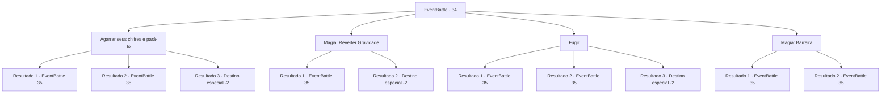

# Eventos de combate · 34

[Índice da tabela](index.md) · [Índice geral](../index.md)

ID: `pt:EventBattle:34` · Fonte: `EventBattle4` · Versão: 1.2.47.

Mapeamento estático dos arquivos; a disponibilidade e a execução dependem do estado da run.

## Texto do evento

Você está atravessando uma planície rochosa quando ouve um estrondo vindo do solo. Você vê uma criatura de metal brilhante no horizonte. Parece um touro feito de aço e está avançando em sua direção mais rápido do que um cavalo de corrida. |drawing_rushGorgon|

## Dados de entrada

```json
{
  "id": 34,
  "grade": 1,
  "monster": "51",
  "required": "1_2_80"
}
```

## Mapa das escolhas



## Escolhas e resultados

### Escolha 1

Agarrar seus chifres e pará-lo

Requisitos e outros campos da escolha:

```json
{
  "required": ""
}
```

#### Resultado 1.1

Você aprende da maneira mais difícil que não pode parar uma criatura gigante de metal de alta velocidade só com suas próprias mãos. A fera bate em você, fazendo você voar alguns metros para trás. Então o {0} se vira e ataca você novamente.

Continuação registrada: [Evento 35](0035.md) na mesma tabela.

```json
{
  "required": "",
  "chance": "25",
  "nextEvent": 35,
  "type": 1,
  "reward": "6_1_0|0_0_-1",
  "place": 0
}
```

#### Resultado 1.2

Você tem força suficiente para parar o {0} por seus chifres. Seus braços e mãos ficam dormentes com o choque quando você é empurrado alguns metros para trás, mas consegue fazer a fera parar. O {0} parece surpreso, mas logo abre suas mandíbulas e cospe fumaça verde. Você solta seus chifres para evitá-lo, e o {0} balança seus chifres em você mais uma vez.

Continuação registrada: [Evento 35](0035.md) na mesma tabela.

```json
{
  "required": "",
  "chance": "1|0_5_1",
  "nextEvent": 35,
  "type": 0,
  "reward": "6_1_0",
  "place": 0
}
```

#### Resultado 1.3

Sua força prova ser sobre-humana. Você dobra os chifres com as mãos nuas, além de interrompê-lo. O {0} fica aterrorizado e foge.

Continuação registrada: [Destino especial `-2`](../destinos-especiais.md).

```json
{
  "required": "1_5_20",
  "chance": "1|0_5_1",
  "nextEvent": -2,
  "type": 0,
  "reward": "0_2_3"
}
```

### Escolha 2

Magia: Reverter Gravidade

Requisitos e outros campos da escolha:

```json
{
  "required": "20_0_4|1_1_2"
}
```

#### Resultado 2.1

Você se lembra de um feitiço melhor do que aquele que gera barreiras, mas o feitiço é muito complicado para uma janela de tempo tão estreita. O {0} bate em você, fazendo você voar alguns metros para trás. Então o {0} se vira e ataca você novamente.

Continuação registrada: [Evento 35](0035.md) na mesma tabela.

```json
{
  "required": "",
  "chance": "11",
  "nextEvent": 35,
  "type": 1,
  "reward": "6_1_0|0_0_-1",
  "place": 0
}
```

#### Resultado 2.2

Você se lembra de um feitiço melhor do que aquele que gera barreiras. Você executa com sucesso um movimento complexo e um feitiço para gerar um campo de gravidade reversa à sua frente. O {0} corre para ele e é levantado no ar. Você sai correndo da área para o caso da vaca louca de metal começar a persegui-lo novamente.

Continuação registrada: [Destino especial `-2`](../destinos-especiais.md).

```json
{
  "required": "",
  "chance": "1|0_14_1",
  "nextEvent": -2,
  "type": 0,
  "reward": "0_2_1|0_0_-1"
}
```

### Escolha 3

Fugir

Requisitos e outros campos da escolha:

```json
{
  "required": ""
}
```

#### Resultado 3.1

Você corre o mais rápido que pode, mas o {0} o alcança. Ele bate nas suas costas, fazendo você voar alguns metros à frente. Então o {0} se vira e ataca você novamente.

Continuação registrada: [Evento 35](0035.md) na mesma tabela.

```json
{
  "required": "2_6_14",
  "chance": "14",
  "nextEvent": 35,
  "type": 1,
  "reward": "6_1_0|0_0_-1",
  "place": 0
}
```

#### Resultado 3.2

Você corre o mais rápido que pode, mas o {0} o alcança. Quando ele está prestes a bater em suas costas, você desvia por pouco de seus chifres pulando para cima. Você pousa com segurança no chão, e o {0} se vira e volta a atacar.

Continuação registrada: [Evento 35](0035.md) na mesma tabela.

```json
{
  "required": "1_6_14",
  "chance": "14",
  "nextEvent": 35,
  "type": 1,
  "reward": "6_1_0",
  "place": 0
}
```

#### Resultado 3.3

O {0} ainda está longe. Você corre o mais rápido que pode para fora do território do {0}, e o {0} para de persegui-lo.

Continuação registrada: [Destino especial `-2`](../destinos-especiais.md).

```json
{
  "required": "",
  "chance": "1|0_6_1",
  "nextEvent": -2,
  "type": 0,
  "reward": ""
}
```

### Escolha 4

Magia: Barreira

Requisitos e outros campos da escolha:

```json
{
  "required": "20_0_2|1_1_2"
}
```

#### Resultado 4.1

Você gera uma barreira invisível. Mas o {0} o estilhaça com seus chifres como se fosse vidro, arremeçando você alguns metros para trás. Em seguida, o {0} se vira e ataca você novamente.

Continuação registrada: [Evento 35](0035.md) na mesma tabela.

```json
{
  "required": "",
  "chance": "26",
  "nextEvent": 35,
  "type": 1,
  "reward": "6_1_0|0_0_-1|0_1_-1",
  "place": 0
}
```

#### Resultado 4.2

Você gera uma barreira invisível. Ele aguenta um golpe dos poderosos chifres do {0}. Mas então começa a rachar e se desfazer em pedaços.

Continuação registrada: [Evento 35](0035.md) na mesma tabela.

```json
{
  "required": "",
  "chance": "1|0_7_1|0_12_1",
  "nextEvent": 35,
  "type": 0,
  "reward": "6_1_0|0_1_-1",
  "place": 0
}
```

## Referências que chegam a este evento

Nenhum `nextEvent` positivo da mesma tabela aponta para este nó. Isso não prova que seja inacessível: sorteio e estado de história podem selecioná-lo.

