# Eventos de combate · 36

[Índice da tabela](index.md) · [Índice geral](../index.md)

ID: `pt:EventBattle:36` · Fonte: `EventBattle4` · Versão: 1.2.47.

Mapeamento estático dos arquivos; a disponibilidade e a execução dependem do estado da run.

## Texto do evento

Você se depara com uma pilha de sujeira formada por um deslizamento de terra. Você está prestes a contornar isso quando um {0} surge da sujeira. Ele olha para você com seus olhos de várias camadas.

## Dados de entrada

```json
{
  "id": 36,
  "grade": 1,
  "monster": "4_1_20|5|28_0_20",
  "required": ""
}
```

## Mapa das escolhas

```mermaid
flowchart TD
  E["EventBattle · 36"]
  C0["Acertá-lo na cabeça"]
  E --> C0
  R0_0["Resultado 1 · EventBattle 37"]
  C0 --> R0_0
  R0_1["Resultado 2 · Destino especial -2"]
  C0 --> R0_1
  C1["Correr"]
  E --> C1
  R1_0["Resultado 1 · Destino especial -2"]
  C1 --> R1_0
  C2["Alimentá-lo"]
  E --> C2
  R2_0["Resultado 1 · Destino especial -2"]
  C2 --> R2_0
  R2_1["Resultado 2 · Destino especial -2"]
  C2 --> R2_1
  R2_2["Resultado 3 · Destino especial -2"]
  C2 --> R2_2
  R2_3["Resultado 4 · Destino especial -2"]
  C2 --> R2_3
  R2_4["Resultado 5 · EventBattle 31"]
  C2 --> R2_4
  C3["Escalar"]
  E --> C3
  R3_0["Resultado 1 · EventBattle 37"]
  C3 --> R3_0
  R3_1["Resultado 2 · Destino especial -2"]
  C3 --> R3_1
  R3_2["Resultado 3 · Destino especial -2"]
  C3 --> R3_2
  R3_3["Resultado 4 · Destino especial -2"]
  C3 --> R3_3
```



## Escolhas e resultados

### Escolha 1

Acertá-lo na cabeça

Requisitos e outros campos da escolha:

```json
{
  "required": ""
}
```

#### Resultado 1.1

Você saca sua arma e acerta o {0} na cabeça. Mas não é o suficiente para matá-lo. O {0} fica agitado e salta para fora da sujeira.

Continuação registrada: [Evento 37](0037.md) na mesma tabela.

```json
{
  "required": "",
  "chance": "12",
  "nextEvent": 37,
  "type": 1,
  "reward": "6_1_0",
  "place": 1
}
```

#### Resultado 1.2

Você pega sua arma e acerta o {0} na cabeça. O {0} morre instantaneamente e seu fluido encharca a sujeira. Você contorna a pilha para encontrar outro caminho.

Continuação registrada: [Destino especial `-2`](../destinos-especiais.md).

```json
{
  "required": "",
  "chance": "1|0_5_1",
  "nextEvent": -2,
  "type": 0,
  "reward": "0_2_1|0_4_20"
}
```

### Escolha 2

Correr

Requisitos e outros campos da escolha:

```json
{
  "required": ""
}
```

#### Resultado 2.1

Você se afasta lentamente antes de correr a toda velocidade. O {0} gasta muito tempo lutando para sair da sujeira e não pode persegui-lo.

Continuação registrada: [Destino especial `-2`](../destinos-especiais.md).

```json
{
  "required": "",
  "chance": "1",
  "nextEvent": -2,
  "type": 2,
  "reward": ""
}
```

### Escolha 3

Alimentá-lo

Requisitos e outros campos da escolha:

```json
{
  "required": ""
}
```

#### Resultado 3.1

Você tira um peixe de sua mochila e o joga no {0}. Você sai correndo da área enquanto o {0} fica preocupado com o peixe.

Continuação registrada: [Destino especial `-2`](../destinos-especiais.md).

```json
{
  "required": "8_124_1",
  "chance": "1",
  "nextEvent": -2,
  "type": 2,
  "reward": "4_124_1"
}
```

#### Resultado 3.2

Você tira um peixe de sua mochila e o joga no {0}. Você sai correndo da área enquanto o {0} fica preocupado com o peixe.

Continuação registrada: [Destino especial `-2`](../destinos-especiais.md).

```json
{
  "required": "8_125_1",
  "chance": "1",
  "nextEvent": -2,
  "type": 2,
  "reward": "4_125_1"
}
```

#### Resultado 3.3

Você tira um peixe de sua mochila e o joga no {0}. Você sai correndo da área enquanto o {0} fica preocupado com o peixe.

Continuação registrada: [Destino especial `-2`](../destinos-especiais.md).

```json
{
  "required": "8_143_1",
  "chance": "1",
  "nextEvent": -2,
  "type": 2,
  "reward": "4_143_1"
}
```

#### Resultado 3.4

Você tira um peixe de sua mochila e o joga no {0}. Você sai correndo da área enquanto o {0} fica preocupado com o peixe.

Continuação registrada: [Destino especial `-2`](../destinos-especiais.md).

```json
{
  "required": "8_144_1",
  "chance": "1",
  "nextEvent": -2,
  "type": 2,
  "reward": "4_144_1"
}
```

#### Resultado 3.5

Você vasculha sua mochila, mas não encontra nada que valha a pena comer. O {0} mostra os dentes e avança em sua direção.

Continuação registrada: [Evento 31](0031.md) na mesma tabela.

```json
{
  "required": "10_124_1|10_125_1|10_143_1|10_144_1",
  "chance": "1",
  "nextEvent": 31,
  "type": 2,
  "reward": "6_1_0",
  "place": 1
}
```

### Escolha 4

Escalar

Requisitos e outros campos da escolha:

```json
{
  "required": ""
}
```

#### Resultado 4.1

Você tenta escalar o {0} e a pilha de sujeira. Mas o {0} não pretende deixar você ir. O {0} agarra seu tornozelo enquanto você tenta pular sobre a pilha.

Continuação registrada: [Evento 37](0037.md) na mesma tabela.

```json
{
  "required": "",
  "chance": "15",
  "nextEvent": 37,
  "type": 1,
  "reward": "0_0_-1|6_1_0",
  "place": 1
}
```

#### Resultado 4.2

Você pisa na cabeça do {0} e salta sobre a pilha com agilidade e graciosidade. Depois de pousar sem esforço do outro lado, você se afasta da área para continuar sua jornada.

Continuação registrada: [Destino especial `-2`](../destinos-especiais.md).

```json
{
  "required": "",
  "chance": "1|0_6_1",
  "nextEvent": -2,
  "type": 0,
  "reward": ""
}
```

#### Resultado 4.3

Você lança um feitiço simples para levitar a si mesmo. O {0} range as mandíbulas enquanto olha para você. Você pousa do outro lado sem esforço e se afasta da área para continuar sua jornada.

Continuação registrada: [Destino especial `-2`](../destinos-especiais.md).

```json
{
  "required": "20_0_2",
  "chance": "1",
  "nextEvent": -2,
  "type": 0,
  "reward": ""
}
```

#### Resultado 4.4

Você se levita no ar. Então você flutua sobre a pilha com facilidade.

Continuação registrada: [Destino especial `-2`](../destinos-especiais.md).

```json
{
  "required": "20_10_1",
  "chance": "1",
  "nextEvent": -2,
  "type": 0,
  "reward": ""
}
```

## Referências que chegam a este evento

Nenhum `nextEvent` positivo da mesma tabela aponta para este nó. Isso não prova que seja inacessível: sorteio e estado de história podem selecioná-lo.

