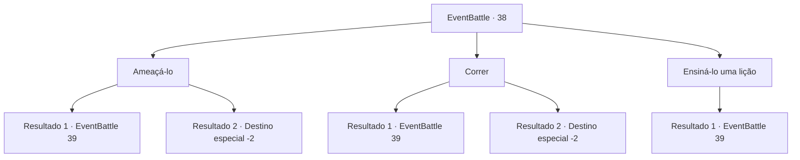

# Eventos de combate · 38

[Índice da tabela](index.md) · [Índice geral](../index.md)

ID: `pt:EventBattle:38` · Fonte: `EventBattle4` · Versão: 1.2.47.

Mapeamento estático dos arquivos; a disponibilidade e a execução dependem do estado da run.

## Texto do evento

Você está escalando uma montanha rochosa coberta de cascalho, quando vê vários cadáveres empalados por piques saindo do chão. Ossos de humanos, anões e gnomos estão espalhados pelas terras. Você tenta sair da cena terrível, quando um {0} aparece de trás das rochas. Ao contrário da maioria dos outros trolls, ele está vestido com uma armadura e empunha um porrete enorme. Ele baba ao olhar para você. 

 "Krrgh... carne fresca. Mim sentir fome."


## Dados de entrada

```json
{
  "id": 38,
  "grade": 1,
  "monster": "39",
  "required": "1_2_55"
}
```

## Mapa das escolhas



## Escolhas e resultados

### Escolha 1

Ameaçá-lo

Requisitos e outros campos da escolha:

```json
{
  "required": ""
}
```

#### Resultado 1.1

O {0} não recua. Sua respiração se intensifica enquanto começa a balançar seu porrete.

Continuação registrada: [Evento 39](0039.md) na mesma tabela.

```json
{
  "required": "",
  "chance": "17",
  "nextEvent": 39,
  "type": 1,
  "reward": "6_1_0",
  "place": 5
}
```

#### Resultado 1.2

Oprimido pelo seu carisma, o troll foge.

Continuação registrada: [Destino especial `-2`](../destinos-especiais.md).

```json
{
  "required": "",
  "chance": "1|0_12_1",
  "nextEvent": -2,
  "type": 0,
  "reward": "0_2_1"
}
```

### Escolha 2

Correr

Requisitos e outros campos da escolha:

```json
{
  "required": ""
}
```

#### Resultado 2.1

Você tenta correr do {0}, mas ele é muito mais ágil do que você pensava. Antes que você perceba, o {0} bloqueia seu caminho e começa a balançar o enorme porrete.

Continuação registrada: [Evento 39](0039.md) na mesma tabela.

```json
{
  "required": "",
  "chance": "14",
  "nextEvent": 39,
  "type": 1,
  "reward": "6_1_0",
  "place": 5
}
```

#### Resultado 2.2

Você ultrapassou {0} com sucesso com sua agilidade incomparável. O {0} tenta persegui-lo, mas logo fica sem fôlego.

Continuação registrada: [Destino especial `-2`](../destinos-especiais.md).

```json
{
  "required": "",
  "chance": "1|0_6_1",
  "nextEvent": -2,
  "type": 0,
  "reward": ""
}
```

### Escolha 3

Ensiná-lo uma lição

Requisitos e outros campos da escolha:

```json
{
  "required": ""
}
```

#### Resultado 3.1

Você decide ensinar ao {0} babão uma lição que ele nunca se esquecerá.

Continuação registrada: [Evento 39](0039.md) na mesma tabela.

```json
{
  "required": "",
  "chance": "1",
  "nextEvent": 39,
  "type": 2,
  "reward": "6_1_0",
  "place": 5
}
```

## Referências que chegam a este evento

Nenhum `nextEvent` positivo da mesma tabela aponta para este nó. Isso não prova que seja inacessível: sorteio e estado de história podem selecioná-lo.

