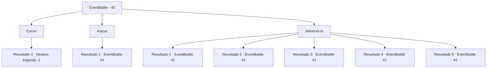

# Eventos de combate · 40

[Índice da tabela](index.md) · [Índice geral](../index.md)

ID: `pt:EventBattle:40` · Fonte: `EventBattle4` · Versão: 1.2.47.

Mapeamento estático dos arquivos; a disponibilidade e a execução dependem do estado da run.

## Texto do evento

|drawing_tiredDolphin|/ Você está caminhando na praia quando vê um golfinho deitado na areia. Ele parece exausto ao olhar para você com seus olhos redondos e brilhantes. De repente, um {0} emerge da água atrás do golfinho. O {0} vê você e seu estranho grito se espalha por seu corpo escamoso. <link=shake>

 "HSSSSSCHAARGH!"

</link>

## Dados de entrada

```json
{
  "id": 40,
  "grade": 1,
  "monster": "35",
  "required": "5_155_0|1_2_30"
}
```

## Mapa das escolhas



## Escolhas e resultados

### Escolha 1

Correr

Requisitos e outros campos da escolha:

```json
{
  "required": ""
}
```

#### Resultado 1.1

Você ignora os olhares desesperados do golfinho e sai correndo. Logo, você ouve o grito do golfinho ecoar atrás de você.

Continuação registrada: [Destino especial `-2`](../destinos-especiais.md).

```json
{
  "required": "",
  "chance": "1",
  "nextEvent": -2,
  "type": 2,
  "reward": ""
}
```

### Escolha 2

Atacar

Requisitos e outros campos da escolha:

```json
{
  "required": ""
}
```

#### Resultado 2.1

Você balança sua arma para a estranha criatura diante de você. O golfinho parece torcer por você com os olhos.

Continuação registrada: [Evento 41](0041.md) na mesma tabela.

```json
{
  "required": "",
  "chance": "1",
  "nextEvent": 41,
  "type": 2,
  "reward": "6_1_0",
  "place": 8
}
```

### Escolha 3

Alimentá-lo

Requisitos e outros campos da escolha:

```json
{
  "required": ""
}
```

#### Resultado 3.1

Você tira um peixe de sua mochila e o joga no {0}. Mas um único peixe não pode distrair o {0} do golfinho. O {0} grita e ataca você.

Continuação registrada: [Evento 41](0041.md) na mesma tabela.

```json
{
  "required": "8_124_1",
  "chance": "1",
  "nextEvent": 41,
  "type": 2,
  "reward": "4_124_1|6_1_0",
  "place": 8
}
```

#### Resultado 3.2

Você tira um peixe de sua mochila e o joga no {0}. Mas um único peixe não pode distrair o {0} do golfinho. O {0} grita e ataca você.

Continuação registrada: [Evento 41](0041.md) na mesma tabela.

```json
{
  "required": "8_125_1",
  "chance": "1",
  "nextEvent": 41,
  "type": 2,
  "reward": "4_125_1|6_1_0",
  "place": 8
}
```

#### Resultado 3.3

Você tira um peixe de sua mochila e o joga no {0}. Mas um único peixe não pode distrair o {0} do golfinho. O {0} grita e ataca você.

Continuação registrada: [Evento 41](0041.md) na mesma tabela.

```json
{
  "required": "8_143_1",
  "chance": "1",
  "nextEvent": 41,
  "type": 2,
  "reward": "4_143_1|6_1_0",
  "place": 8
}
```

#### Resultado 3.4

Você tira um peixe de sua mochila e o joga no {0}. Mas um único peixe não pode distrair o {0} do golfinho. O {0} grita e ataca você.

Continuação registrada: [Evento 41](0041.md) na mesma tabela.

```json
{
  "required": "8_144_1",
  "chance": "1",
  "nextEvent": 41,
  "type": 2,
  "reward": "4_144_1|6_1_0",
  "place": 8
}
```

#### Resultado 3.5

Você decide alimentar o {0} para distraí-lo, mas ele percebe que não tem nada com você. O {0} mostra os dentes e começa a atirar magia em você.

Continuação registrada: [Evento 41](0041.md) na mesma tabela.

```json
{
  "required": "10_124_1|10_125_1|10_143_1|10_144_1",
  "chance": "1",
  "nextEvent": 41,
  "type": 2,
  "reward": "6_1_0",
  "place": 8
}
```

## Referências que chegam a este evento

Nenhum `nextEvent` positivo da mesma tabela aponta para este nó. Isso não prova que seja inacessível: sorteio e estado de história podem selecioná-lo.

