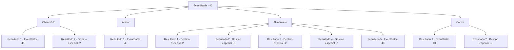

# Eventos de combate · 42

[Índice da tabela](index.md) · [Índice geral](../index.md)

ID: `pt:EventBattle:42` · Fonte: `EventBattle4` · Versão: 1.2.47.

Mapeamento estático dos arquivos; a disponibilidade e a execução dependem do estado da run.

## Texto do evento

|drawing_camp| Você está relaxando em frente a uma fogueira num acampamento, desfrutando o crepitar do fogo. Você sente que, repentinamente, tudo está quieto demais, porém avista os olhos de {0}. O {0} faminto encara você conforme se aproxima lentamente. O {0} rosna para você como se estivesse exigindo comida, pronto para atacar a qualquer momento.

## Dados de entrada

```json
{
  "id": 42,
  "grade": 1,
  "monster": "3|6|27_0_30",
  "required": ""
}
```

## Mapa das escolhas



## Escolhas e resultados

### Escolha 1

Observá-lo

Requisitos e outros campos da escolha:

```json
{
  "required": ""
}
```

#### Resultado 1.1

Você olha para {0} com um olhar mortal em seus olhos. Mas o {0} o ignora e avança direto para você.

Continuação registrada: [Evento 43](0043.md) na mesma tabela.

```json
{
  "required": "",
  "chance": "10",
  "nextEvent": 43,
  "type": 1,
  "reward": "6_1_0",
  "place": 1
}
```

#### Resultado 1.2

Você olha para {0} com um olhar mortal em seus olhos. O {0} choraminga e foge.

Continuação registrada: [Destino especial `-2`](../destinos-especiais.md).

```json
{
  "required": "",
  "chance": "1|0_12_1",
  "nextEvent": -2,
  "type": 0,
  "reward": "0_2_1"
}
```

### Escolha 2

Atacar

Requisitos e outros campos da escolha:

```json
{
  "required": ""
}
```

#### Resultado 2.1

Você agilmente fecha a lacuna com o {0} e começa a atacá-lo.

Continuação registrada: [Evento 43](0043.md) na mesma tabela.

```json
{
  "required": "",
  "chance": "1",
  "nextEvent": 43,
  "type": 2,
  "reward": "6_1_0",
  "place": 1
}
```

### Escolha 3

Alimentá-lo

Requisitos e outros campos da escolha:

```json
{
  "required": ""
}
```

#### Resultado 3.1

{0} pega sua comida no ar. Em seguida, se afasta enquanto olha para você antes de desaparecer nos arbustos.

Continuação registrada: [Destino especial `-2`](../destinos-especiais.md).

```json
{
  "required": "8_124_1",
  "chance": "1",
  "nextEvent": -2,
  "type": 2,
  "reward": "4_124_1|0_2_1"
}
```

#### Resultado 3.2

{0} pega sua comida no ar. Em seguida, se afasta enquanto olha para você antes de desaparecer nos arbustos.

Continuação registrada: [Destino especial `-2`](../destinos-especiais.md).

```json
{
  "required": "8_125_1",
  "chance": "1",
  "nextEvent": -2,
  "type": 2,
  "reward": "4_125_1|0_2_1"
}
```

#### Resultado 3.3

{0} pega sua comida no ar. Em seguida, se afasta enquanto olha para você antes de desaparecer nos arbustos.

Continuação registrada: [Destino especial `-2`](../destinos-especiais.md).

```json
{
  "required": "8_143_1",
  "chance": "1",
  "nextEvent": -2,
  "type": 2,
  "reward": "4_143_1|0_2_1"
}
```

#### Resultado 3.4

{0} pega sua comida no ar. Em seguida, se afasta enquanto olha para você antes de desaparecer nos arbustos.

Continuação registrada: [Destino especial `-2`](../destinos-especiais.md).

```json
{
  "required": "8_144_1",
  "chance": "1",
  "nextEvent": -2,
  "type": 2,
  "reward": "4_144_1|0_2_1"
}
```

#### Resultado 3.5

Você decide alimentar {0} como forma de distração, mas ele percebe que não tem nada com você. {0} mostra seus dentes e avança até você.

Continuação registrada: [Evento 43](0043.md) na mesma tabela.

```json
{
  "required": "10_124_1|10_125_1|10_143_1|10_144_1",
  "chance": "1",
  "nextEvent": 43,
  "type": 2,
  "reward": "6_1_0",
  "place": 1
}
```

### Escolha 4

Correr

Requisitos e outros campos da escolha:

```json
{
  "required": ""
}
```

#### Resultado 4.1

Você tenta correr, mas {0} te ultrapassa e começa a te atacar.

Continuação registrada: [Evento 43](0043.md) na mesma tabela.

```json
{
  "required": "",
  "chance": "10",
  "nextEvent": 43,
  "type": 1,
  "reward": "6_1_0",
  "place": 1
}
```

#### Resultado 4.2

Você despista o {0} com sucesso e consegue escapar.

Continuação registrada: [Destino especial `-2`](../destinos-especiais.md).

```json
{
  "required": "",
  "chance": "1|0_6_1",
  "nextEvent": -2,
  "type": 0,
  "reward": ""
}
```

## Referências que chegam a este evento

Nenhum `nextEvent` positivo da mesma tabela aponta para este nó. Isso não prova que seja inacessível: sorteio e estado de história podem selecioná-lo.

