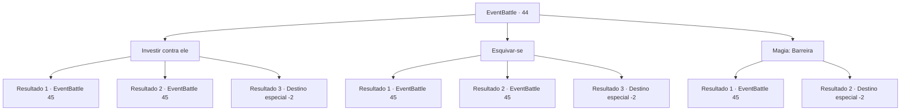

# Eventos de combate · 44

[Índice da tabela](index.md) · [Índice geral](../index.md)

ID: `pt:EventBattle:44` · Fonte: `EventBattle4` · Versão: 1.2.47.

Mapeamento estático dos arquivos; a disponibilidade e a execução dependem do estado da run.

## Texto do evento

Você chega na periferia de uma aldeia e então ouve um barulho inesperado. É o som de uma respiração ofegante misturada com o som de algo quebrando. Você segue o som e encontra um furioso {0} quebrando as cercas desordenadamente. Com um hálito quente saindo de suas narinas, o {0} o percebe, e avança em sua direção.

## Dados de entrada

```json
{
  "id": 44,
  "grade": 1,
  "monster": "46|96_0_25|121_0_35",
  "required": "1_2_10|2_2_80"
}
```

## Mapa das escolhas



## Escolhas e resultados

### Escolha 1

Investir contra ele

Requisitos e outros campos da escolha:

```json
{
  "required": ""
}
```

#### Resultado 1.1

Você se joga na entrada {0}.
 <link=shake>'Thwuck!'</link>
 O impacto produz um som pesado, enviando você rolando pelo chão.

Continuação registrada: [Evento 45](0045.md) na mesma tabela.

```json
{
  "required": "",
  "chance": "30",
  "nextEvent": 45,
  "type": 1,
  "reward": "0_0_-1|6_1_0",
  "place": 4
}
```

#### Resultado 1.2

Você se joga na entrada {0}.
 <link=shake>'Thwuck!'</link>
 O impacto produz um som pesado à medida que o {0} diminui.

Continuação registrada: [Evento 45](0045.md) na mesma tabela.

```json
{
  "required": "",
  "chance": "1|0_5_2",
  "nextEvent": 45,
  "type": 0,
  "reward": "6_1_0",
  "place": 4
}
```

#### Resultado 1.3

Você se joga na entrada {0}.
 <link=shake>'Thwuck!'</link>
 O impacto produz um som pesado, e o {0} tropeça no chão. O {0} parou de se mover completamente.

Continuação registrada: [Destino especial `-2`](../destinos-especiais.md).

```json
{
  "required": "",
  "chance": "1|0_5_1",
  "nextEvent": -2,
  "type": 0,
  "reward": "0_2_1|0_4_20"
}
```

### Escolha 2

Esquivar-se 

Requisitos e outros campos da escolha:

```json
{
  "required": ""
}
```

#### Resultado 2.1

O {0} é incrivelmente rápido, e ele bate em você e o faz rolar pelo chão antes que você possa se esquivar.

Continuação registrada: [Evento 45](0045.md) na mesma tabela.

```json
{
  "required": "",
  "chance": "30",
  "nextEvent": 45,
  "type": 1,
  "reward": "0_0_-1|6_1_0",
  "place": 4
}
```

#### Resultado 2.2

Você é ágil o suficiente para evitar o ataque {0}.
 'Hrmph!'
 Outra rajada de vento quente dispara das narinas de {0} enquanto olha para você.

Continuação registrada: [Evento 45](0045.md) na mesma tabela.

```json
{
  "required": "",
  "chance": "1|0_6_2",
  "nextEvent": 45,
  "type": 0,
  "reward": "6_1_0",
  "place": 4
}
```

#### Resultado 2.3

Você desvia do ataque do {0} rolando sob ele, e consegue atacar a perna do {0}. Seu golpe acerta com uma precisão mortal e faz o {0} cair no chão. O {0} parou de se mover completamente.

Continuação registrada: [Destino especial `-2`](../destinos-especiais.md).

```json
{
  "required": "",
  "chance": "1|0_6_1",
  "nextEvent": -2,
  "type": 0,
  "reward": "0_2_1|0_4_20"
}
```

### Escolha 3

Magia: Barreira

Requisitos e outros campos da escolha:

```json
{
  "required": "20_0_2|1_1_2"
}
```

#### Resultado 3.1

Você produz uma barreira e a usa contra a entrada {0}.
 <link=shake>'thwump!'</link>
 A barreira quebra com um baque pesado.

Continuação registrada: [Evento 45](0045.md) na mesma tabela.

```json
{
  "required": "",
  "chance": "20",
  "nextEvent": 45,
  "type": 1,
  "reward": "6_1_0|0_1_-1",
  "place": 4
}
```

#### Resultado 3.2

Você se joga na entrada {0}.
 <link=shake>'thwump!' </link>
 O impacto produz um som pesado, e o {0} tropeça no chão. O {0} parou de se mover completamente.

Continuação registrada: [Destino especial `-2`](../destinos-especiais.md).

```json
{
  "required": "",
  "chance": "1|0_7_1|0_12_1",
  "nextEvent": -2,
  "type": 0,
  "reward": "0_2_1|0_4_20|0_1_-1"
}
```

## Referências que chegam a este evento

Nenhum `nextEvent` positivo da mesma tabela aponta para este nó. Isso não prova que seja inacessível: sorteio e estado de história podem selecioná-lo.

