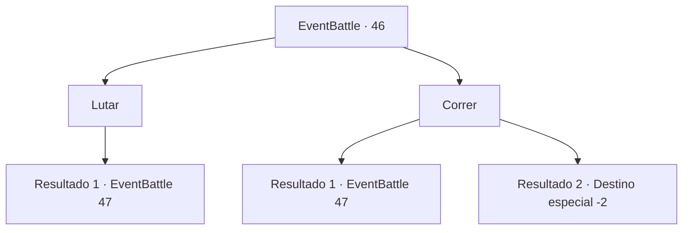

# Eventos de combate · 46

[Índice da tabela](index.md) · [Índice geral](../index.md)

ID: `pt:EventBattle:46` · Fonte: `EventBattle4` · Versão: 1.2.47.

Mapeamento estático dos arquivos; a disponibilidade e a execução dependem do estado da run.

## Texto do evento

Você está tateando através de uma caverna de pedra com paredes úmidas. A caverna parece ameaçadora, com incontáveis ​​fragmentos de equipamentos de aventureiros espalhados pelo chão. Você está procurando rastros, quando um {0} surge de dentro da caverna.

## Dados de entrada

```json
{
  "id": 46,
  "grade": 1,
  "monster": "8_0_10|1_1_20|4_1_20|5_0_10|22_0_10|33_1_20|63_0_10|77_1_20",
  "required": ""
}
```

## Mapa das escolhas



## Escolhas e resultados

### Escolha 1

Lutar

Requisitos e outros campos da escolha:

```json
{
  "required": ""
}
```

#### Resultado 1.1

Você observa os movimentos do {0} enquanto segura sua arma.

Continuação registrada: [Evento 47](0047.md) na mesma tabela.

```json
{
  "required": "",
  "chance": "1",
  "nextEvent": 47,
  "type": 2,
  "reward": "6_1_0",
  "place": 6
}
```

### Escolha 2

Correr

Requisitos e outros campos da escolha:

```json
{
  "required": ""
}
```

#### Resultado 2.1

Você tenta correr. Mas o {0} é mais rápido.

Continuação registrada: [Evento 47](0047.md) na mesma tabela.

```json
{
  "required": "",
  "chance": "10",
  "nextEvent": 47,
  "type": 1,
  "reward": "6_1_0",
  "place": 6
}
```

#### Resultado 2.2

Você sai rapidamente da caverna.

Continuação registrada: [Destino especial `-2`](../destinos-especiais.md).

```json
{
  "required": "",
  "chance": "1|0_6_1",
  "nextEvent": -2,
  "type": 0,
  "reward": ""
}
```

## Referências que chegam a este evento

Nenhum `nextEvent` positivo da mesma tabela aponta para este nó. Isso não prova que seja inacessível: sorteio e estado de história podem selecioná-lo.

