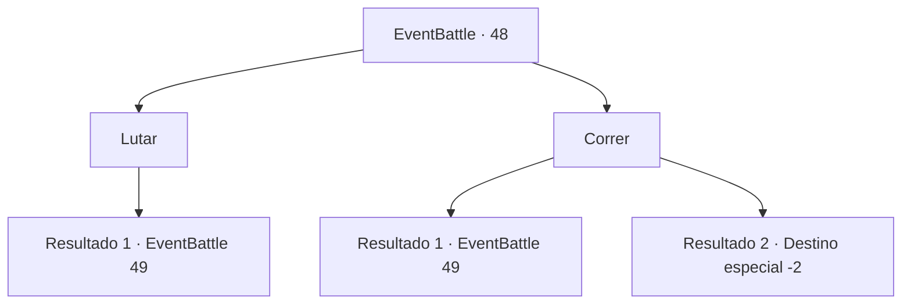

# Eventos de combate · 48

[Índice da tabela](index.md) · [Índice geral](../index.md)

ID: `pt:EventBattle:48` · Fonte: `EventBattle4` · Versão: 1.2.47.

Mapeamento estático dos arquivos; a disponibilidade e a execução dependem do estado da run.

## Texto do evento

Você está caminhando por uma floresta densa, com pouca luz solar. Você se lembra do relato de um comerciante sobre um {0} à solta nessas partes da floresta, então olha com cuidado por onda anda. Você está no meio da floresta quando um {0} salta e te ataca. Você imediatamente se vira e se esquiva do ataque. O {0} segue habilmente com uma sequência de golpes, como se já tivesse feito isso muitas vezes antes.

## Dados de entrada

```json
{
  "id": 48,
  "grade": 1,
  "monster": "1_1_15|6_1_15|7_1_15|8_0_15|22_0_15|33_1_15",
  "required": "2_2_50"
}
```

## Mapa das escolhas



## Escolhas e resultados

### Escolha 1

Lutar

Requisitos e outros campos da escolha:

```json
{
  "required": ""
}
```

#### Resultado 1.1

Você sacode sua arma e analisa os ataques do {0}.

Continuação registrada: [Evento 49](0049.md) na mesma tabela.

```json
{
  "required": "",
  "chance": "1",
  "nextEvent": 49,
  "type": 2,
  "reward": "6_1_0",
  "place": 1
}
```

### Escolha 2

Correr

Requisitos e outros campos da escolha:

```json
{
  "required": ""
}
```

#### Resultado 2.1

Você pula para aumentar a distância e começa a correr. Mas o {0} corre e por ser um habitat familiar ele o alcança.

Continuação registrada: [Evento 49](0049.md) na mesma tabela.

```json
{
  "required": "",
  "chance": "15",
  "nextEvent": 49,
  "type": 1,
  "reward": "6_1_0",
  "place": 1
}
```

#### Resultado 2.2

Você pula para aumentar a distância e começa a correr. Felizmente, você é rápido o suficiente para superar o {0}.

Continuação registrada: [Destino especial `-2`](../destinos-especiais.md).

```json
{
  "required": "",
  "chance": "1|0_6_1",
  "nextEvent": -2,
  "type": 0,
  "reward": ""
}
```

## Referências que chegam a este evento

Nenhum `nextEvent` positivo da mesma tabela aponta para este nó. Isso não prova que seja inacessível: sorteio e estado de história podem selecioná-lo.

