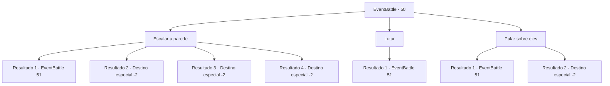

# Eventos de combate · 50

[Índice da tabela](index.md) · [Índice geral](../index.md)

ID: `pt:EventBattle:50` · Fonte: `EventBattle4` · Versão: 1.2.47.

Mapeamento estático dos arquivos; a disponibilidade e a execução dependem do estado da run.

## Texto do evento

Você está passando por um desfiladeiro estreito formado na fenda de uma rocha gigante. No meio do caminho, você vê um grupo de {0}s bloqueando o caminho. Eles gritam e uivam enquanto se aproximam de você.

## Dados de entrada

```json
{
  "id": 50,
  "grade": 1,
  "monster": "1|2|6|7|22_0_10|33",
  "required": "2_2_40"
}
```

## Mapa das escolhas



## Escolhas e resultados

### Escolha 1

Escalar a parede

Requisitos e outros campos da escolha:

```json
{
  "required": ""
}
```

#### Resultado 1.1

Você agarra a parede do desfiladeiro e começa a subir para cima. Mas logo você fica sem força e cai em direção aos {0}s esperando abaixo.

Continuação registrada: [Evento 51](0051.md) na mesma tabela.

```json
{
  "required": "",
  "chance": "15",
  "nextEvent": 51,
  "type": 1,
  "reward": "0_0_-1|6_1_0",
  "place": 5
}
```

#### Resultado 1.2

Você agarra a parede do desfiladeiro e começa a subir. Os {0}s olham para você, com as mandíbulas abertas e vazias. Você chega ao topo e olha para os {0}s gritando antes de continuar sua jornada.

Continuação registrada: [Destino especial `-2`](../destinos-especiais.md).

```json
{
  "required": "",
  "chance": "1|0_5_1",
  "nextEvent": -2,
  "type": 0,
  "reward": "0_2_1"
}
```

#### Resultado 1.3

Você decide ir pelo ar. Os {0}s olham para você, mandíbulas abertas e vazias. Você chega ao topo e olha para os {0}s gritando antes de continuar sua jornada.

Continuação registrada: [Destino especial `-2`](../destinos-especiais.md).

```json
{
  "required": "20_10_1",
  "chance": "1",
  "nextEvent": -2,
  "type": 2,
  "reward": "0_2_1"
}
```

#### Resultado 1.4

Você decide ir pelo ar. Os {0}s olham para você, mandíbulas abertas e vazias. Você chega ao topo e olha para os {0}s gritando antes de continuar sua jornada.

Continuação registrada: [Destino especial `-2`](../destinos-especiais.md).

```json
{
  "required": "20_0_1",
  "chance": "1",
  "nextEvent": -2,
  "type": 2,
  "reward": "0_2_1"
}
```

### Escolha 2

Lutar

Requisitos e outros campos da escolha:

```json
{
  "required": ""
}
```

#### Resultado 2.1

Você avança até {0}s que estão no seu caminho.

Continuação registrada: [Evento 51](0051.md) na mesma tabela.

```json
{
  "required": "",
  "chance": "1",
  "nextEvent": 51,
  "type": 2,
  "reward": "6_1_0",
  "place": 5
}
```

### Escolha 3

Pular sobre eles

Requisitos e outros campos da escolha:

```json
{
  "required": ""
}
```

#### Resultado 3.1

Você tenta pular por cima dos {0}s saindo da parede do desfiladeiro. Mas os {0}s agarram sua perna e fazem você cair no chão.

Continuação registrada: [Evento 51](0051.md) na mesma tabela.

```json
{
  "required": "",
  "chance": "15",
  "nextEvent": 51,
  "type": 1,
  "reward": "0_0_-1|6_1_0",
  "place": 5
}
```

#### Resultado 3.2

Você pula os {0}s saindo da parede do desfiladeiro. Os {0}s tentam agarrá-lo, mas você gira no ar para desfazer os agarrões. Os {0}s tropeçam e tombam uns sobre os outros. Você pousa graciosamente e continua a caminhar pelo vale, enquanto os {0}s atrás de você lutam para se desembaraçar.

Continuação registrada: [Destino especial `-2`](../destinos-especiais.md).

```json
{
  "required": "",
  "chance": "1|0_6_1",
  "nextEvent": -2,
  "type": 0,
  "reward": "0_2_1"
}
```

## Referências que chegam a este evento

Nenhum `nextEvent` positivo da mesma tabela aponta para este nó. Isso não prova que seja inacessível: sorteio e estado de história podem selecioná-lo.

