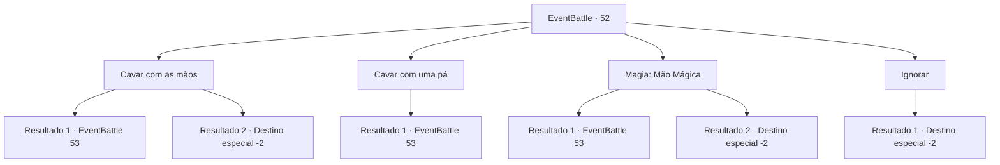

# Eventos de combate · 52

[Índice da tabela](index.md) · [Índice geral](../index.md)

ID: `pt:EventBattle:52` · Fonte: `EventBattle4` · Versão: 1.2.47.

Mapeamento estático dos arquivos; a disponibilidade e a execução dependem do estado da run.

## Texto do evento

Você sente uma rajada de vento forte atingir você. Você cospe a areia que se alojou na sua boca e continua a andar apressadamente. Nesse exato momento, algo prende seu pé. Quando você olha para baixo, vê uma figura enterrada na areia.

## Dados de entrada

```json
{
  "id": 52,
  "grade": 1,
  "monster": "17_0_70|95_0_35",
  "required": "1_2_35"
}
```

## Mapa das escolhas



## Escolhas e resultados

### Escolha 1

Cavar com as mãos

Requisitos e outros campos da escolha:

```json
{
  "required": ""
}
```

#### Resultado 1.1

Você cava o monte de terra com as mãos nuas. Depois de cerca de dez minutos de escavação, um pesado baú fechado foi revelado. Ao abrir o antigo baú, uma onda de calor intenso sai de dentro. E assim que você recua do calor, uma chama imensa se ergue e {0} aparece.

Continuação registrada: [Evento 53](0053.md) na mesma tabela.

```json
{
  "required": "",
  "chance": "1|0_5_1",
  "nextEvent": 53,
  "type": 0,
  "reward": "6_1_0",
  "place": 5
}
```

#### Resultado 1.2

Você cava o monte de terra com as mãos nuas. Depois de cerca de dez minutos de escavação, um pesado baú fechado foi revelado.  Você tenta abri-lo, mas o baú permaneceu imóvel, sem se abrir. No final, você decidiu deixá-lo para trás e seguir em frente para outro lugar.

Continuação registrada: [Destino especial `-2`](../destinos-especiais.md).

```json
{
  "required": "",
  "chance": "14",
  "nextEvent": -2,
  "type": 1,
  "reward": ""
}
```

### Escolha 2

Cavar com uma pá

Requisitos e outros campos da escolha:

```json
{
  "required": "8_38_1"
}
```

#### Resultado 2.1

Você cava o monte de terra com uma pá. Depois de cerca de dez minutos de escavação, um pesado baú fechado foi revelado. Ao abrir o antigo baú, uma onda de calor intenso sai de dentro. E assim que você recua do calor, uma chama imensa se ergue e {0} apareceu.

Continuação registrada: [Evento 53](0053.md) na mesma tabela.

```json
{
  "required": "",
  "chance": "1",
  "nextEvent": 53,
  "type": 2,
  "reward": "6_1_0",
  "place": 5
}
```

### Escolha 3

Magia: Mão Mágica

Requisitos e outros campos da escolha:

```json
{
  "required": "20_0_1"
}
```

#### Resultado 3.1

Você usa magia para cavar o monte de terra. Depois de cerca de dez minutos de escavação, um pesado baú fechado foi revelado. Ao abrir o antigo baú, uma onda de calor intenso sai de dentro. E assim que você recua do calor, uma chama imensa se ergue e {0} apareceu.

Continuação registrada: [Evento 53](0053.md) na mesma tabela.

```json
{
  "required": "",
  "chance": "1|0_7_1",
  "nextEvent": 53,
  "type": 0,
  "reward": "6_1_0",
  "place": 5
}
```

#### Resultado 3.2

Você usa magia para cavar o monte de terra. Depois de cerca de dez minutos de escavação, um pesado baú fechado foi revelado. Você tenta abri-lo, mas o baú permaneceu imóvel, sem se abrir. No final, você decidiu deixá-lo para trás e seguir em frente para outro lugar.

Continuação registrada: [Destino especial `-2`](../destinos-especiais.md).

```json
{
  "required": "",
  "chance": "14",
  "nextEvent": -2,
  "type": 1,
  "reward": ""
}
```

### Escolha 4

Ignorar

Requisitos e outros campos da escolha:

```json
{
  "required": ""
}
```

#### Resultado 4.1

Você ignora o que estava preso em seus pés e continua caminhando.

Continuação registrada: [Destino especial `-2`](../destinos-especiais.md).

```json
{
  "required": "",
  "chance": "1",
  "nextEvent": -2,
  "type": 2,
  "reward": ""
}
```

## Referências que chegam a este evento

Nenhum `nextEvent` positivo da mesma tabela aponta para este nó. Isso não prova que seja inacessível: sorteio e estado de história podem selecioná-lo.

