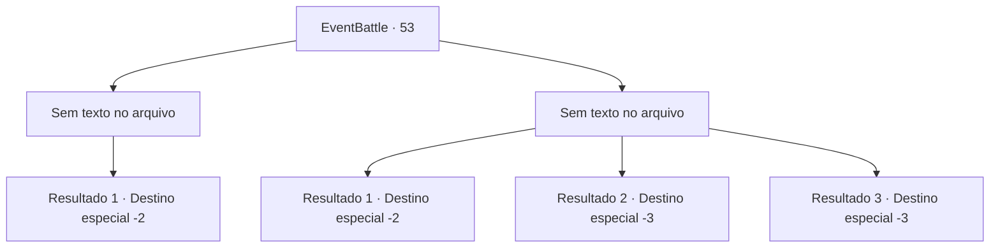

# Eventos de combate · 53

[Índice da tabela](index.md) · [Índice geral](../index.md)

ID: `pt:EventBattle:53` · Fonte: `EventBattle4` · Versão: 1.2.47.

Mapeamento estático dos arquivos; a disponibilidade e a execução dependem do estado da run.

## Texto do evento

*Sem texto no arquivo.*

## Dados de entrada

```json
{
  "id": 53,
  "grade": 1,
  "monster": "",
  "required": ""
}
```

## Mapa das escolhas



## Escolhas e resultados

### Escolha 1

*Sem texto no arquivo; o papel dessa opção depende da interface do jogo.*

Requisitos e outros campos da escolha:

```json
{
  "required": ""
}
```

#### Resultado 1.1

Depois de derrotar o monstro, você tenta saquear o conteúdo do baú. No entanto, o baú já havia sido reduzido a cinzas e não restava nada dentro dele.

Continuação registrada: [Destino especial `-2`](../destinos-especiais.md).

```json
{
  "required": "",
  "chance": "1",
  "nextEvent": -2,
  "type": 2,
  "reward": ""
}
```

### Escolha 2

*Sem texto no arquivo; o papel dessa opção depende da interface do jogo.*

Requisitos e outros campos da escolha:

```json
{
  "required": ""
}
```

#### Resultado 2.1

As chamas irrompem com uma intensidade que parece consumir tudo ao seu redor. Sentindo-se ameaçado e em perigo, você rapidamente foge do local.

Continuação registrada: [Destino especial `-2`](../destinos-especiais.md).

```json
{
  "required": "1_0_2|1_1_2",
  "chance": "1",
  "nextEvent": -2,
  "type": 2,
  "reward": "0_0_-1|0_1_-1"
}
```

#### Resultado 2.2

As chamas envolvem você intensamente, causando sua completa destruição. Não restou nada além de cinzas, pois você foi completamente consumido pelo fogo.

Continuação registrada: [Destino especial `-3`](../destinos-especiais.md).

```json
{
  "required": "2_0_2",
  "chance": "1",
  "nextEvent": -3,
  "type": 2,
  "reward": "0_0_-1|0_1_-1"
}
```

#### Resultado 2.3

As chamas intensas consumiram você. Você queimou completamente, sem deixar nem mesmo cinzas.

Continuação registrada: [Destino especial `-3`](../destinos-especiais.md).

```json
{
  "required": "2_1_2",
  "chance": "1",
  "nextEvent": -3,
  "type": 2,
  "reward": "0_0_-1|0_1_-1"
}
```

## Referências que chegam a este evento

- [Evento 52 · escolha 1 · resultado 1](0052.md#escolha-1)
- [Evento 52 · escolha 2 · resultado 1](0052.md#escolha-2)
- [Evento 52 · escolha 3 · resultado 1](0052.md#escolha-3)
