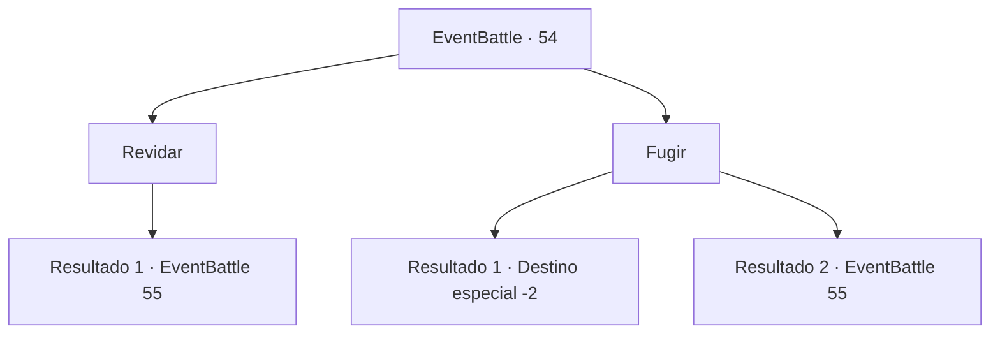

# Eventos de combate · 54

[Índice da tabela](index.md) · [Índice geral](../index.md)

ID: `pt:EventBattle:54` · Fonte: `EventBattle4` · Versão: 1.2.47.

Mapeamento estático dos arquivos; a disponibilidade e a execução dependem do estado da run.

## Texto do evento

Ao atravessar o vale, você percebe um cheiro terrível vindo de uma fenda estreita nas rochas. Você acelera o passo, tentando fugir daquele lugar o mais rápido possível. Porém, dentro do desfiladeiro, {0} aparece te ataca.

## Dados de entrada

```json
{
  "id": 54,
  "grade": 1,
  "monster": "143_0_35|100_0_20|152_0_35",
  "required": "1_2_20"
}
```

## Mapa das escolhas



## Escolhas e resultados

### Escolha 1

Revidar

Requisitos e outros campos da escolha:

```json
{
  "required": ""
}
```

#### Resultado 1.1

Você ataca rapidamente {0}. Após desviar brevemente do ataque, ele rosna e vem em sua direção novamente.

Continuação registrada: [Evento 55](0055.md) na mesma tabela.

```json
{
  "required": "",
  "chance": "1",
  "nextEvent": 55,
  "type": 2,
  "reward": "6_1_0",
  "place": 1
}
```

### Escolha 2

Fugir

Requisitos e outros campos da escolha:

```json
{
  "required": ""
}
```

#### Resultado 2.1

Sem dúvida, há um caminho conectado a uma dimensão maligna naquela fenda. Você está fugindo de lá com todas as suas forças.

Continuação registrada: [Destino especial `-2`](../destinos-especiais.md).

```json
{
  "required": "",
  "chance": "1|0_6_1",
  "nextEvent": -2,
  "type": 0,
  "reward": ""
}
```

#### Resultado 2.2

Sem dúvida, há uma passagem conectada a uma dimensão maligna naquela fenda. Você tenta escapar de lá com todas as suas forças, mas {0} não vai deixar você fugir.

Continuação registrada: [Evento 55](0055.md) na mesma tabela.

```json
{
  "required": "",
  "chance": "11",
  "nextEvent": 55,
  "type": 1,
  "reward": "6_1_0",
  "place": 1
}
```

## Referências que chegam a este evento

Nenhum `nextEvent` positivo da mesma tabela aponta para este nó. Isso não prova que seja inacessível: sorteio e estado de história podem selecioná-lo.

