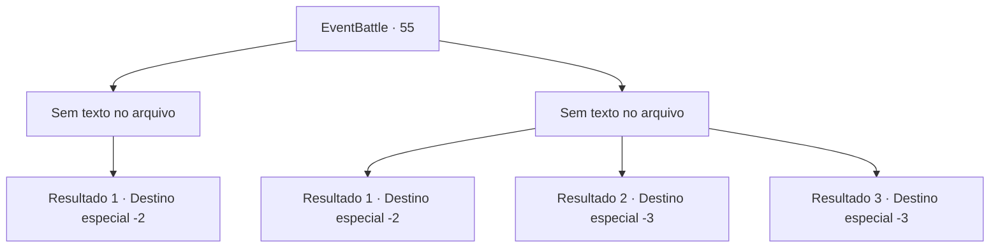

# Eventos de combate · 55

[Índice da tabela](index.md) · [Índice geral](../index.md)

ID: `pt:EventBattle:55` · Fonte: `EventBattle4` · Versão: 1.2.47.

Mapeamento estático dos arquivos; a disponibilidade e a execução dependem do estado da run.

## Texto do evento

*Sem texto no arquivo.*

## Dados de entrada

```json
{
  "id": 55,
  "grade": 1,
  "monster": "",
  "required": ""
}
```

## Mapa das escolhas



## Escolhas e resultados

### Escolha 1

*Sem texto no arquivo; o papel dessa opção depende da interface do jogo.*

Requisitos e outros campos da escolha:

```json
{
  "required": ""
}
```

#### Resultado 1.1

Você derrota {0} e empurra o corpo para a fenda. A fenda está conectada a uma fenda da dimensão do mal, e à medida que o corpo é engolido, ela se fecha rapidamente.

Continuação registrada: [Destino especial `-2`](../destinos-especiais.md).

```json
{
  "required": "",
  "chance": "1",
  "nextEvent": -2,
  "type": 2,
  "reward": ""
}
```

### Escolha 2

*Sem texto no arquivo; o papel dessa opção depende da interface do jogo.*

Requisitos e outros campos da escolha:

```json
{
  "required": ""
}
```

#### Resultado 2.1

Você corre com toda a sua força e eventualmente consegue escapar da perseguição de {0}.

Continuação registrada: [Destino especial `-2`](../destinos-especiais.md).

```json
{
  "required": "1_0_2|1_1_2",
  "chance": "1",
  "nextEvent": -2,
  "type": 2,
  "reward": "0_0_-1|0_1_-1"
}
```

#### Resultado 2.2

Você sofreu um golpe fatal e desabou, sua força deixando suas pernas. Ao ver seu estado, {0} exibe suas presas afiadas e sorri. Sem hesitação, ele corta sua respiração, encerrando sua vida.

Continuação registrada: [Destino especial `-3`](../destinos-especiais.md).

```json
{
  "required": "2_0_2",
  "chance": "1",
  "nextEvent": -3,
  "type": 2,
  "reward": "0_0_-1|0_1_-1"
}
```

#### Resultado 2.3

Você sofreu um golpe fatal e desabou, sua força deixando suas pernas. Ao ver seu estado, {0} mostra suas presas afiadas e sorri. Sem hesitação, ele corta sua respiração, encerrando sua vida.

Continuação registrada: [Destino especial `-3`](../destinos-especiais.md).

```json
{
  "required": "2_1_2",
  "chance": "1",
  "nextEvent": -3,
  "type": 2,
  "reward": "0_0_-1|0_1_-1"
}
```

## Referências que chegam a este evento

- [Evento 54 · escolha 1 · resultado 1](0054.md#escolha-1)
- [Evento 54 · escolha 2 · resultado 2](0054.md#escolha-2)
