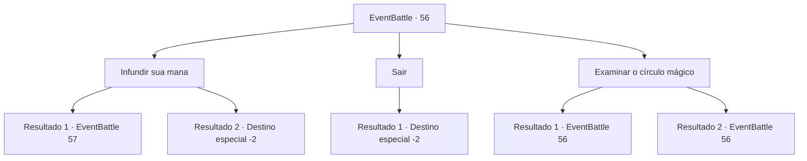

# Eventos de combate · 56

[Índice da tabela](index.md) · [Índice geral](../index.md)

ID: `pt:EventBattle:56` · Fonte: `EventBattle4` · Versão: 1.2.47.

Mapeamento estático dos arquivos; a disponibilidade e a execução dependem do estado da run.

## Texto do evento

Numa planície com vista para o horizonte, você se depara com um prédio abandonado enterrado em um monte de areia. Parecia que uma parte do espaço havia sido recortada e jogada aqui. A curiosidade te leva a entrar no edifício e a explorar lentamente o seu interior. O quarto e os móveis estavam completamente empoeirados, como se estivesse inabitado há muito. Olhando ao redor da sala, você nota um círculo mágico vermelho gravado no chão do corredor.

## Dados de entrada

```json
{
  "id": 56,
  "grade": 1,
  "monster": "15_0_50|17_0_75|43_0_75",
  "required": "1_2_50|5_574_0"
}
```

## Mapa das escolhas



## Escolhas e resultados

### Escolha 1

Infundir sua mana

Requisitos e outros campos da escolha:

```json
{
  "required": "20_0_1"
}
```

#### Resultado 1.1

Você infunde mana cautelosamente no círculo mágico. Então, de repente, uma luz sinistra irrompe do círculo mágico, revelando {0}. Ele solta um grito e começa a te atacar.

Continuação registrada: [Evento 57](0057.md) na mesma tabela.

```json
{
  "required": "",
  "chance": "1",
  "nextEvent": 57,
  "type": 2,
  "reward": "6_1_0",
  "place": 10
}
```

#### Resultado 1.2

Você infunde mana cautelosamente no círculo mágico. Então, um baú antigo e desgastado aparece do círculo mágico. Dentro do baú, há pergaminhos completamente arruinados e uma única flauta de chifre. Você os pega e foge rapidamente do prédio.

Continuação registrada: [Destino especial `-2`](../destinos-especiais.md).

```json
{
  "required": "",
  "chance": "1",
  "nextEvent": -2,
  "type": 2,
  "reward": "3_181_1|5_574_1|0_2_1"
}
```

### Escolha 2

Sair

Requisitos e outros campos da escolha:

```json
{
  "required": ""
}
```

#### Resultado 2.1

Você foge rapidamente do prédio suspeito.

Continuação registrada: [Destino especial `-2`](../destinos-especiais.md).

```json
{
  "required": "",
  "chance": "1",
  "nextEvent": -2,
  "type": 2,
  "reward": ""
}
```

### Escolha 3

Examinar o círculo mágico

Requisitos e outros campos da escolha:

```json
{
  "required": "5_575_0"
}
```

#### Resultado 3.1

Você examina o círculo mágico vermelho. Os símbolos geométricos inscritos no círculo mágico indicam claramente que ele é destinado a invocar algo. No entanto, algumas partes dos símbolos estão apagadas, então você não consegue determinar exatamente o que é pretendido invocar.

Continuação registrada: [Evento 56](0056.md) na mesma tabela.

```json
{
  "required": "",
  "chance": "1|0_7_1",
  "nextEvent": 56,
  "type": 0,
  "reward": "5_575_1"
}
```

#### Resultado 3.2

Você examinou o círculo mágico, mas com seu conhecimento limitado, é impossível para você interpretar seu significado.

Continuação registrada: [Evento 56](0056.md) na mesma tabela.

```json
{
  "required": "",
  "chance": "13",
  "nextEvent": 56,
  "type": 1,
  "reward": "5_575_1"
}
```

## Referências que chegam a este evento

- [Evento 56 · escolha 3 · resultado 1](0056.md#escolha-3)
- [Evento 56 · escolha 3 · resultado 2](0056.md#escolha-3)
