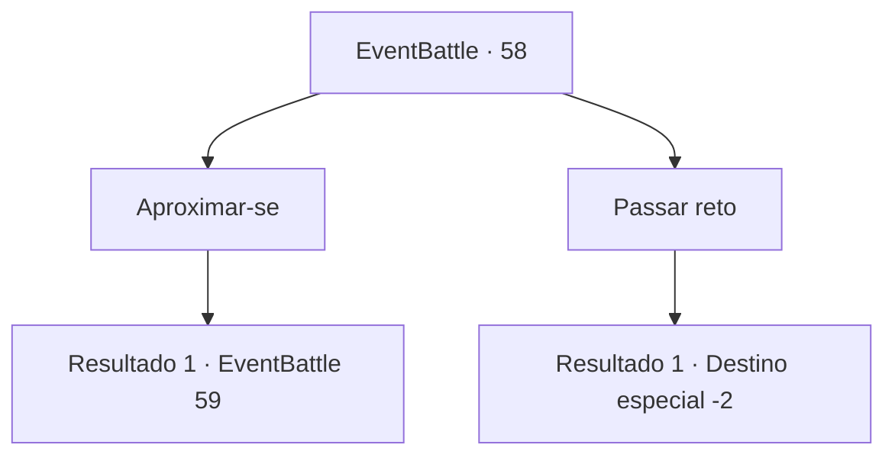

# Eventos de combate · 58

[Índice da tabela](index.md) · [Índice geral](../index.md)

ID: `pt:EventBattle:58` · Fonte: `EventBattle4` · Versão: 1.2.47.

Mapeamento estático dos arquivos; a disponibilidade e a execução dependem do estado da run.

## Texto do evento

Você está caminhando por uma costa isolada onde poucos se aventuram. O silêncio tranquilo só é interrompido pelo som das ondas se chocando. Só então você percebe o que parece ser uma rede abandonada em um lado da costa. Algo dentro da rede começa a se mexer lentamente.

## Dados de entrada

```json
{
  "id": 58,
  "grade": 1,
  "monster": "13_1_20|35_0_20|44_0_20",
  "required": "2_2_60"
}
```

## Mapa das escolhas



## Escolhas e resultados

### Escolha 1

Aproximar-se

Requisitos e outros campos da escolha:

```json
{
  "required": ""
}
```

#### Resultado 1.1

Você se aproxima cautelosamente da coisa presa na rede para ter uma melhor visão. De repente, {0} salta da rede e te ataca. Você rapidamente saca sua arma e se defende da emboscada.

Continuação registrada: [Evento 59](0059.md) na mesma tabela.

```json
{
  "required": "",
  "chance": "1",
  "nextEvent": 59,
  "type": 2,
  "reward": "6_1_0",
  "place": 8
}
```

### Escolha 2

Passar reto

Requisitos e outros campos da escolha:

```json
{
  "required": ""
}
```

#### Resultado 2.1

Você passa pela rede, e o farfalhar da rede se acalma logo em seguida.

Continuação registrada: [Destino especial `-2`](../destinos-especiais.md).

```json
{
  "required": "",
  "chance": "1",
  "nextEvent": -2,
  "type": 2,
  "reward": ""
}
```

## Referências que chegam a este evento

Nenhum `nextEvent` positivo da mesma tabela aponta para este nó. Isso não prova que seja inacessível: sorteio e estado de história podem selecioná-lo.

