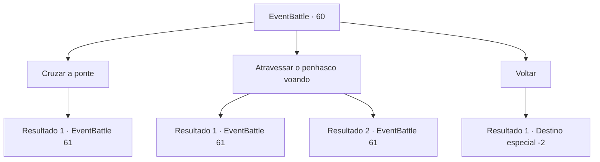

# Eventos de combate · 60

[Índice da tabela](index.md) · [Índice geral](../index.md)

ID: `pt:EventBattle:60` · Fonte: `EventBattle4` · Versão: 1.2.47.

Mapeamento estático dos arquivos; a disponibilidade e a execução dependem do estado da run.

## Texto do evento

Uma ponte frágil feita de tábuas e cordas pende precariamente entre penhascos íngremes. À primeira vista, parece perigosamente instável, balançando incessantemente nos ventos furiosos.

## Dados de entrada

```json
{
  "id": 60,
  "grade": 1,
  "monster": "40_0_20|96_0_25",
  "required": "1_2_20|2_2_70"
}
```

## Mapa das escolhas



## Escolhas e resultados

### Escolha 1

Cruzar a ponte

Requisitos e outros campos da escolha:

```json
{
  "required": ""
}
```

#### Resultado 1.1

Você atravessa cautelosamente a ponte, segurando a corda para se apoiar. Nesse exato momento, {0} mergulha do céu, indo direto em sua direção na ponte.

Continuação registrada: [Evento 61](0061.md) na mesma tabela.

```json
{
  "required": "",
  "chance": "1",
  "nextEvent": 61,
  "type": 2,
  "reward": "6_1_0",
  "place": 1
}
```

### Escolha 2

Atravessar o penhasco voando

Requisitos e outros campos da escolha:

```json
{
  "required": "-1|20_10_1|20_0_1"
}
```

#### Resultado 2.1

Você tenta voar pelo ar para atravessar o penhasco. No entanto, {0} mergulha do céu, voando em tua direção.

Continuação registrada: [Evento 61](0061.md) na mesma tabela.

```json
{
  "required": "20_10_1",
  "chance": "1",
  "nextEvent": 61,
  "type": 2,
  "reward": "6_1_0",
  "place": 1
}
```

#### Resultado 2.2

Você tenta voar pelo ar para atravessar o penhasco. No entanto, {0} mergulha do céu, voando em tua direção.

Continuação registrada: [Evento 61](0061.md) na mesma tabela.

```json
{
  "required": "20_0_1",
  "chance": "1",
  "nextEvent": 61,
  "type": 2,
  "reward": "6_1_0",
  "place": 1
}
```

### Escolha 3

Voltar

Requisitos e outros campos da escolha:

```json
{
  "required": ""
}
```

#### Resultado 3.1

Você decide não atravessar a ponte.

Continuação registrada: [Destino especial `-2`](../destinos-especiais.md).

```json
{
  "required": "",
  "chance": "1",
  "nextEvent": -2,
  "type": 2,
  "reward": ""
}
```

## Referências que chegam a este evento

Nenhum `nextEvent` positivo da mesma tabela aponta para este nó. Isso não prova que seja inacessível: sorteio e estado de história podem selecioná-lo.

