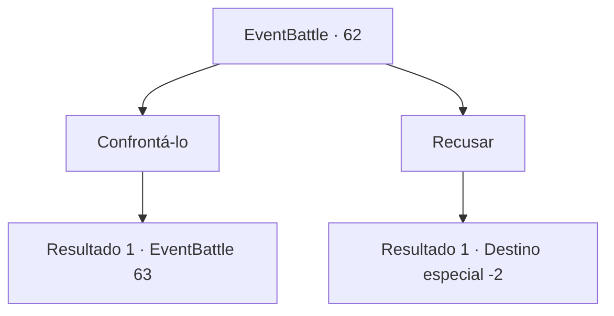

# Eventos de combate · 62

[Índice da tabela](index.md) · [Índice geral](../index.md)

ID: `pt:EventBattle:62` · Fonte: `EventBattle4` · Versão: 1.2.47.

Mapeamento estático dos arquivos; a disponibilidade e a execução dependem do estado da run.

## Texto do evento

Enquanto você está passando por uma cidade, alguém na estrada se aproxima de você e inicia uma conversa. Ele parece bastante confiante em suas habilidades. 

 "Ei, aventureiro. Se estiver com tempo, gostaria de um pequeno desafio?"


## Dados de entrada

```json
{
  "id": 62,
  "grade": 1,
  "monster": "61_1_20|62_0_20",
  "required": ""
}
```

## Mapa das escolhas



## Escolhas e resultados

### Escolha 1

Confrontá-lo

Requisitos e outros campos da escolha:

```json
{
  "required": ""
}
```

#### Resultado 1.1

Você aceita o pedido dele. Ele expressa gratidão e saca uma arma. 

 "Vamos começar!"


Continuação registrada: [Evento 63](0063.md) na mesma tabela.

```json
{
  "required": "",
  "chance": "1",
  "nextEvent": 63,
  "type": 2,
  "reward": "6_1_0",
  "place": 4
}
```

### Escolha 2

Recusar

Requisitos e outros campos da escolha:

```json
{
  "required": ""
}
```

#### Resultado 2.1

Você rejeita a oferta dele. Ele resmunga algo sobre ser uma pena, mas inevitável, então sai em busca de outras oportunidades.

Continuação registrada: [Destino especial `-2`](../destinos-especiais.md).

```json
{
  "required": "",
  "chance": "1",
  "nextEvent": -2,
  "type": 2,
  "reward": ""
}
```

## Referências que chegam a este evento

Nenhum `nextEvent` positivo da mesma tabela aponta para este nó. Isso não prova que seja inacessível: sorteio e estado de história podem selecioná-lo.

