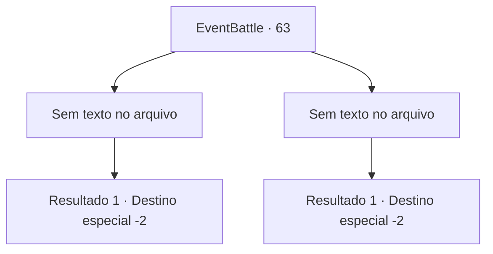

# Eventos de combate · 63

[Índice da tabela](index.md) · [Índice geral](../index.md)

ID: `pt:EventBattle:63` · Fonte: `EventBattle4` · Versão: 1.2.47.

Mapeamento estático dos arquivos; a disponibilidade e a execução dependem do estado da run.

## Texto do evento

*Sem texto no arquivo.*

## Dados de entrada

```json
{
  "id": 63,
  "grade": 1,
  "monster": "",
  "required": ""
}
```

## Mapa das escolhas



## Escolhas e resultados

### Escolha 1

*Sem texto no arquivo; o papel dessa opção depende da interface do jogo.*

Requisitos e outros campos da escolha:

```json
{
  "required": ""
}
```

#### Resultado 1.1

Você demonstra a diferença de habilidade para ele. No final da luta, ofegante ele te diz. 

 "*Arfa*... *Arfa*... O mundo é mesmo vasto e cheio de competidores fortes... Obrigado pelo duelo."

 Você troca cumprimentos com ele e então seguem caminhos separados.

Continuação registrada: [Destino especial `-2`](../destinos-especiais.md).

```json
{
  "required": "",
  "chance": "1",
  "nextEvent": -2,
  "type": 2,
  "reward": ""
}
```

### Escolha 2

*Sem texto no arquivo; o papel dessa opção depende da interface do jogo.*

Requisitos e outros campos da escolha:

```json
{
  "required": ""
}
```

#### Resultado 2.1

Você acaba de joelhos na frente do {0}. Enquanto você respira pesadamente, ele se aproxima e fala. 

 "Obrigado pelo desafio. Adeus."

 Ele se despede de você e parte.

Continuação registrada: [Destino especial `-2`](../destinos-especiais.md).

```json
{
  "required": "",
  "chance": "1",
  "nextEvent": -2,
  "type": 2,
  "reward": ""
}
```

## Referências que chegam a este evento

- [Evento 62 · escolha 1 · resultado 1](0062.md#escolha-1)
