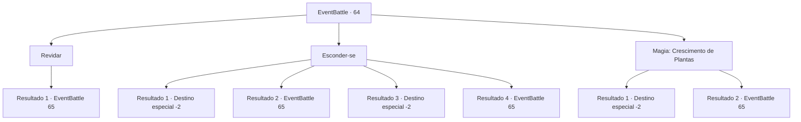

# Eventos de combate · 64

[Índice da tabela](index.md) · [Índice geral](../index.md)

ID: `pt:EventBattle:64` · Fonte: `EventBattle4` · Versão: 1.2.47.

Mapeamento estático dos arquivos; a disponibilidade e a execução dependem do estado da run.

## Texto do evento

Um rugido estrondoso ecoa pela floresta, sacudindo o chão sob seus pés. De longe, você pode ver a figura colossal de {0}, exalando uma presença avassaladora. Como se sentisse seu olhar, ele vira a cabeça e fixa os olhos em você. Num instante, ele solta um grito ensurdecedor e se lança em sua direção.

## Dados de entrada

```json
{
  "id": 64,
  "grade": 1,
  "monster": "39_0_50|132_0_50|140_0_80",
  "required": "1_2_50"
}
```

## Mapa das escolhas



## Escolhas e resultados

### Escolha 1

Revidar

Requisitos e outros campos da escolha:

```json
{
  "required": ""
}
```

#### Resultado 1.1

Você não recusa o desafio de {0}. Em vez disso, decide enfrentá-lo corajosamente.

Continuação registrada: [Evento 65](0065.md) na mesma tabela.

```json
{
  "required": "",
  "chance": "1",
  "nextEvent": 65,
  "type": 2,
  "reward": "6_1_0",
  "place": 1
}
```

### Escolha 2

Esconder-se

Requisitos e outros campos da escolha:

```json
{
  "required": ""
}
```

#### Resultado 2.1

Você oculta sua presença no abraço da floresta. O olhar de {0} falha em te encontrar, e ele simplesmente passa, exalando seu hálito fétido.

Continuação registrada: [Destino especial `-2`](../destinos-especiais.md).

```json
{
  "required": "21_45_1|21_5_2",
  "chance": "1|0_6_1",
  "nextEvent": -2,
  "type": 0,
  "reward": ""
}
```

#### Resultado 2.2

Você tenta esconder a sua presença no abraço da floresta. No entanto, o {0} percebe e avança na sua direção, uivando ameaçadoramente.

Continuação registrada: [Evento 65](0065.md) na mesma tabela.

```json
{
  "required": "21_45_1|21_5_2",
  "chance": "16",
  "nextEvent": 65,
  "type": 1,
  "reward": "6_1_0",
  "place": 1
}
```

#### Resultado 2.3

Você oculta sua presença no abraço da floresta. O olhar de {0} falha em te encontrar, e ele simplesmente passa, exalando seu hálito fétido.

Continuação registrada: [Destino especial `-2`](../destinos-especiais.md).

```json
{
  "required": "21_45_1|20_5_2",
  "chance": "1",
  "nextEvent": -2,
  "type": 2,
  "reward": ""
}
```

#### Resultado 2.4

Você tenta esconder a tua presença no abraço da floresta. No entanto, o {0} percebe e avança na tua direção, uivando ameaçadoramente.

Continuação registrada: [Evento 65](0065.md) na mesma tabela.

```json
{
  "required": "20_45_1",
  "chance": "1",
  "nextEvent": 65,
  "type": 2,
  "reward": "6_1_0",
  "place": 1
}
```

### Escolha 3

Magia: Crescimento de Plantas

Requisitos e outros campos da escolha:

```json
{
  "required": "20_0_2|1_1_2"
}
```

#### Resultado 3.1

Você lança 'Crescimento de Plantas' para aumentar rapidamente as plantas na floresta. As plantas crescidas enredam os tornozelos do monstro, fazendo-o perder o equilíbrio e cair com um estrondo alto. Você aproveita a oportunidade para escapar apressadamente da floresta.

Continuação registrada: [Destino especial `-2`](../destinos-especiais.md).

```json
{
  "required": "",
  "chance": "1|0_7_1",
  "nextEvent": -2,
  "type": 0,
  "reward": "0_1_-1"
}
```

#### Resultado 3.2

Você lança 'Crescimento de Plantas' para aumentar rapidamente as plantas na floresta. Porém, o monstro rasga facilmente as plantas aumentadas. Sua tentativa de ganhar tempo falha e você é obrigado a se preparar para a batalha.

Continuação registrada: [Evento 65](0065.md) na mesma tabela.

```json
{
  "required": "",
  "chance": "16",
  "nextEvent": 65,
  "type": 1,
  "reward": "6_1_0",
  "place": 1
}
```

## Referências que chegam a este evento

Nenhum `nextEvent` positivo da mesma tabela aponta para este nó. Isso não prova que seja inacessível: sorteio e estado de história podem selecioná-lo.

