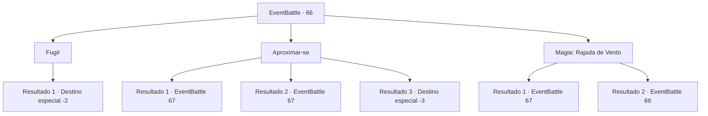

# Eventos de combate · 66

[Índice da tabela](index.md) · [Índice geral](../index.md)

ID: `pt:EventBattle:66` · Fonte: `EventBattle4` · Versão: 1.2.47.

Mapeamento estático dos arquivos; a disponibilidade e a execução dependem do estado da run.

## Texto do evento

De manhã cedo, você está caminhando à beira-mar, cercado por uma espessa neblina que impede sua visão. A cada passo que você dá, um som suave e farfalhante ressoa. De repente, algo vago aparece além da neblina.

## Dados de entrada

```json
{
  "id": 66,
  "grade": 1,
  "monster": "12_1_15|14_0_20|89_0_15",
  "required": "2_2_50"
}
```

## Mapa das escolhas



## Escolhas e resultados

### Escolha 1

Fugir

Requisitos e outros campos da escolha:

```json
{
  "required": ""
}
```

#### Resultado 1.1

Você escapa da criatura que espreitava nas sombras.

Continuação registrada: [Destino especial `-2`](../destinos-especiais.md).

```json
{
  "required": "",
  "chance": "1",
  "nextEvent": -2,
  "type": 2,
  "reward": ""
}
```

### Escolha 2

Aproximar-se

Requisitos e outros campos da escolha:

```json
{
  "required": ""
}
```

#### Resultado 2.1

Você se aproxima da figura espreitando na névoa. Então, o {0} além da névoa ataca. Você rapidamente esquiva de seu ataque e contra-ataca prontamente.

Continuação registrada: [Evento 67](0067.md) na mesma tabela.

```json
{
  "required": "",
  "chance": "1|0_6_1",
  "nextEvent": 67,
  "type": 0,
  "reward": "6_1_0",
  "place": 8
}
```

#### Resultado 2.2

Você se aproxima da figura espreitando na névoa. Então, o {0} além da névoa ataca. Você sangra por conta da emboscada repentina, ele parece ansioso para aproveitar a oportunidade de te matar, atacando imediatamente.

Continuação registrada: [Evento 67](0067.md) na mesma tabela.

```json
{
  "required": "1_0_2",
  "chance": "14",
  "nextEvent": 67,
  "type": 1,
  "reward": "0_0_-1|6_1_0",
  "place": 8
}
```

#### Resultado 2.3

Você se aproxima da figura espreitando na névoa. Então, o {0} além da névoa ataca. Você sangra por conta da emboscada repentina, ele parece ansioso para aproveitar a oportunidade de te matar, atacando imediatamente.

Continuação registrada: [Destino especial `-3`](../destinos-especiais.md).

```json
{
  "required": "2_0_2",
  "chance": "14",
  "nextEvent": -3,
  "type": 1,
  "reward": "0_0_-1"
}
```

### Escolha 3

Magia: Rajada de Vento

Requisitos e outros campos da escolha:

```json
{
  "required": "20_0_1|5_576_0"
}
```

#### Resultado 3.1

Você sopra uma rajada de vento para dispersar a névoa. Como resultado, o {0}, que estava se escondendo na névoa e te mirando, é revelado. Você rapidamente se prepara para contra-atacar.

Continuação registrada: [Evento 67](0067.md) na mesma tabela.

```json
{
  "required": "",
  "chance": "1|0_7_1",
  "nextEvent": 67,
  "type": 0,
  "reward": "6_1_0",
  "place": 8
}
```

#### Resultado 3.2

Você tenta soprar uma rajada de vento para dispersar a neblina, mas falha em lançar o feitiço.

Continuação registrada: [Evento 66](0066.md) na mesma tabela.

```json
{
  "required": "",
  "chance": "11",
  "nextEvent": 66,
  "type": 1,
  "reward": "5_576_1"
}
```

## Referências que chegam a este evento

- [Evento 66 · escolha 3 · resultado 2](0066.md#escolha-3)
