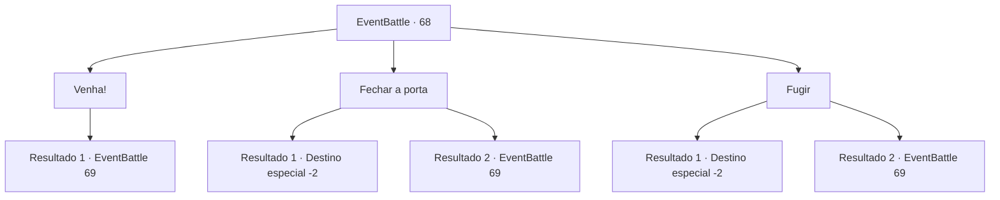

# Eventos de combate · 68

[Índice da tabela](index.md) · [Índice geral](../index.md)

ID: `pt:EventBattle:68` · Fonte: `EventBattle4` · Versão: 1.2.47.

Mapeamento estático dos arquivos; a disponibilidade e a execução dependem do estado da run.

## Texto do evento

Você está na entrada de uma masmorra que encontrou por acaso. A entrada está bloqueada por uma robusta porta de pedra. Com uma demonstração de força, você abre a porta de pedra, revelando o interior oculto da masmorra. No entanto, antes que você possa explora-la, um {0} do fundo da masmorra se aproxima, fazendo barulhos altos de batidas.

## Dados de entrada

```json
{
  "id": 68,
  "grade": 1,
  "monster": "15_0_55|70_0_35|150_0_20",
  "required": "5_577_0"
}
```

## Mapa das escolhas



## Escolhas e resultados

### Escolha 1

Venha!

Requisitos e outros campos da escolha:

```json
{
  "required": ""
}
```

#### Resultado 1.1

Você grita 'Venha!' enquanto se prepara para a luta. {0} avança com um tremendo ímpeto para te atacar.

Continuação registrada: [Evento 69](0069.md) na mesma tabela.

```json
{
  "required": "",
  "chance": "1",
  "nextEvent": 69,
  "type": 2,
  "reward": "6_1_0",
  "place": 7
}
```

### Escolha 2

Fechar a porta

Requisitos e outros campos da escolha:

```json
{
  "required": ""
}
```

#### Resultado 2.1

Você fecha rapidamente a porta com força. {0}, que estava avançando com grande força, fica em silêncio quando a porta se fecha. Você recua lentamente enquanto observa a porta e depois sai da masmorra.

Continuação registrada: [Destino especial `-2`](../destinos-especiais.md).

```json
{
  "required": "",
  "chance": "1|0_5_1",
  "nextEvent": -2,
  "type": 0,
  "reward": ""
}
```

#### Resultado 2.2

O ataque de {0} foi mais rápido do que você fechando a porta. Seu punho feroz acerta sua bochecha. Percebendo que não pode evitar a luta, você revida.

Continuação registrada: [Evento 69](0069.md) na mesma tabela.

```json
{
  "required": "",
  "chance": "13",
  "nextEvent": 69,
  "type": 1,
  "reward": "6_1_0",
  "place": 7
}
```

### Escolha 3

Fugir

Requisitos e outros campos da escolha:

```json
{
  "required": ""
}
```

#### Resultado 3.1

Você esquiva-se rapidamente do ataque do {0} e foge. Surpreendentemente, o monstro que avançava com força não persegue você além da porta. Você recua lentamente enquanto o observa e, em seguida, sai da masmorra.

Continuação registrada: [Destino especial `-2`](../destinos-especiais.md).

```json
{
  "required": "",
  "chance": "1|0_6_1",
  "nextEvent": -2,
  "type": 0,
  "reward": ""
}
```

#### Resultado 3.2

O ataque de {0} foi mais rápido que sua tentativa de fuga. Seu punho cruel acerta sua bochecha. Percebendo que não pode evitar a luta, você revida.

Continuação registrada: [Evento 69](0069.md) na mesma tabela.

```json
{
  "required": "",
  "chance": "13",
  "nextEvent": 69,
  "type": 1,
  "reward": "6_1_0",
  "place": 7
}
```

## Referências que chegam a este evento

Nenhum `nextEvent` positivo da mesma tabela aponta para este nó. Isso não prova que seja inacessível: sorteio e estado de história podem selecioná-lo.

