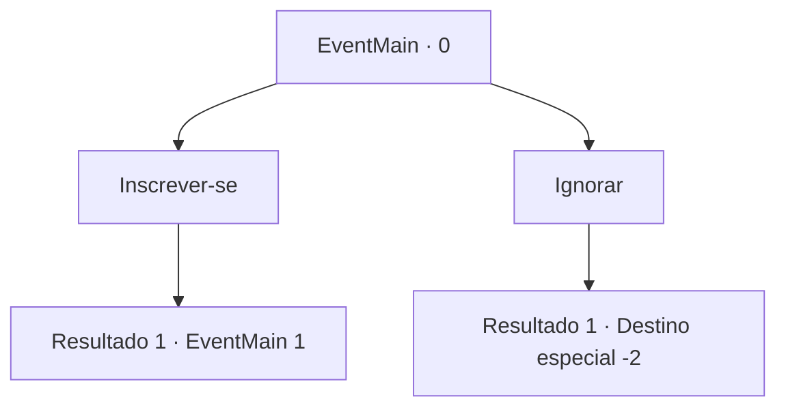

# Eventos principais · 0

[Índice da tabela](index.md) · [Índice geral](../index.md)

ID: `pt:EventMain:0` · Fonte: `EventMain4` · Versão: 1.2.47.

Mapeamento estático dos arquivos; a disponibilidade e a execução dependem do estado da run.

## Texto do evento

|drawing_board|Você lê um folheto de recrutamento de colonos no quadro de avisos da cidade. 

 "Recrutando aventureiros para explorar territórios não reivindicados além das Montanhas Atilante ao norte do Reino.
-Inscreva-se para: Guilda de Aventureiros-"


## Dados de entrada

```json
{
  "id": 0,
  "grade": 1,
  "normalGoal": "0",
  "required": "1_2_10|13_0_0"
}
```

## Mapa das escolhas



## Escolhas e resultados

### Escolha 1

Inscrever-se

Requisitos e outros campos da escolha:

```json
{
  "required": ""
}
```

#### Resultado 1.1

Você passa por um procedimento simples de inscrição na Guilda dos Aventureiros, após o qual o atendente lhe entrega um mapa. Em seguida, você se dirige às Montanhas Atilante. 
...
 Poucos dias depois, você chega ao caminho da montanha. Está sendo guardado por um gigante de gelo. O gigante está cercado por cavalos e pessoas mortas. |drawing_frostGiant|

Continuação registrada: [Evento 1](0001.md) na mesma tabela.

```json
{
  "required": "",
  "chance": "1",
  "nextEvent": 1,
  "type": 2,
  "reward": ""
}
```

### Escolha 2

Ignorar

Requisitos e outros campos da escolha:

```json
{
  "required": ""
}
```

#### Resultado 2.1

Você ignora o quadro de avisos.

Continuação registrada: [Destino especial `-2`](../destinos-especiais.md).

```json
{
  "required": "",
  "chance": "1",
  "nextEvent": -2,
  "type": 2,
  "reward": "13_0_18|0_2_1"
}
```

## Referências que chegam a este evento

Nenhum `nextEvent` positivo da mesma tabela aponta para este nó. Isso não prova que seja inacessível: sorteio e estado de história podem selecioná-lo.

