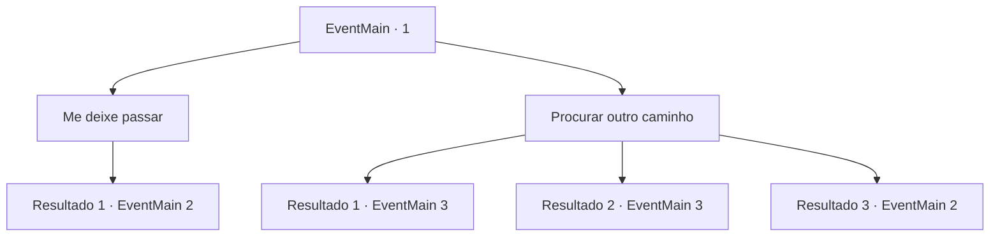

# Eventos principais · 1

[Índice da tabela](index.md) · [Índice geral](../index.md)

ID: `pt:EventMain:1` · Fonte: `EventMain4` · Versão: 1.2.47.

Mapeamento estático dos arquivos; a disponibilidade e a execução dependem do estado da run.

## Texto do evento

*Sem texto no arquivo.*

## Dados de entrada

```json
{
  "id": 1,
  "grade": 1,
  "normalGoal": "0",
  "required": ""
}
```

## Mapa das escolhas



## Escolhas e resultados

### Escolha 1

Me deixe passar

Requisitos e outros campos da escolha:

```json
{
  "required": ""
}
```

#### Resultado 1.1

Você fala com o gigante de gelo. Ele se levanta lentamente para seu pedido. Seus punhos ainda estão com sangue. 

 "Oh... É claro. Mas você terá que passar pela minha boca."


Continuação registrada: [Evento 2](0002.md) na mesma tabela.

```json
{
  "required": "",
  "chance": "1",
  "nextEvent": 2,
  "type": 2,
  "reward": "6_0_42",
  "place": 9
}
```

### Escolha 2

Procurar outro caminho

Requisitos e outros campos da escolha:

```json
{
  "required": ""
}
```

#### Resultado 2.1

Você decide procurar por outro caminho, mas o chão cede sob seus pés. O gigante gargalha e pega você. De repente, ele toma uma flechada no olho. Dando brecha para escapar. 

 "Você está bem? Vamos sair daqui."

 Um estranho se aproxima e te oferece ajuda.

Continuação registrada: [Evento 3](0003.md) na mesma tabela.

```json
{
  "required": "1_0_2",
  "chance": "13",
  "nextEvent": 3,
  "type": 1,
  "reward": "0_0_-1|0_2_1"
}
```

#### Resultado 2.2

Você decide procurar outro caminho, mas o chão desaba sob seus pés. Você cai no fundo de um poço profundo e sua mente começa a divagar.

Continuação registrada: [Evento 3](0003.md) na mesma tabela.

```json
{
  "required": "2_0_2",
  "chance": "13",
  "nextEvent": 3,
  "type": 1,
  "reward": "0_0_-1"
}
```

#### Resultado 2.3

Você decide procurar outro caminho. Mas antes de dar o primeiro passo, você percebe algo estranho no chão. Você olha mais de perto e encontra uma armadilha bem escondida. Conforme você cuidadosamente passa pela armadilha, o gigante de gelo berra de raiva. 

 "Venha aqui, seu pirralho!!"

 Ele tenta pisar em você, mas acaba caindo em sua própria armadilha. A armadilha poderia ter matado pessoas comuns apenas com a queda, mas só é profunda o suficiente para uma das pernas do gigante. 

 "Argh! Você... eu vou esmagar você!"

 Ele culpa você por sua própria estupidez enquanto balança os punhos para você.

Continuação registrada: [Evento 2](0002.md) na mesma tabela.

```json
{
  "required": "",
  "chance": "1|0_14_1",
  "nextEvent": 2,
  "type": 0,
  "reward": "6_2_42",
  "place": 9
}
```

## Referências que chegam a este evento

- [Evento 0 · escolha 1 · resultado 1](0000.md#escolha-1)
