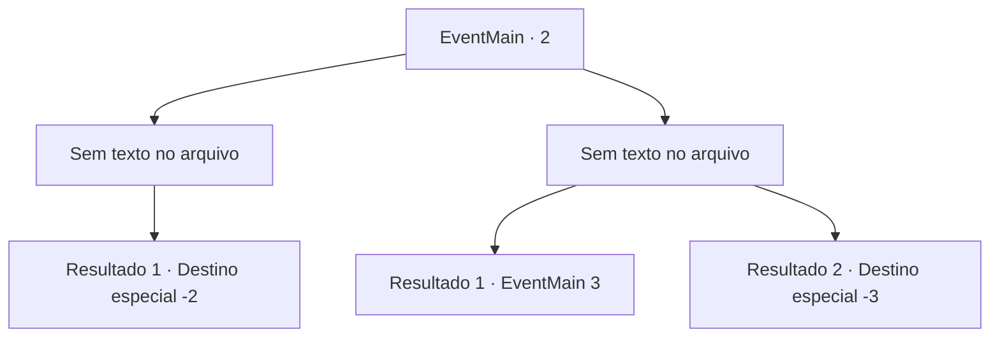

# Eventos principais · 2

[Índice da tabela](index.md) · [Índice geral](../index.md)

ID: `pt:EventMain:2` · Fonte: `EventMain4` · Versão: 1.2.47.

Mapeamento estático dos arquivos; a disponibilidade e a execução dependem do estado da run.

## Texto do evento

*Sem texto no arquivo.*

## Dados de entrada

```json
{
  "id": 2,
  "grade": 1,
  "normalGoal": "0",
  "required": ""
}
```

## Mapa das escolhas



## Escolhas e resultados

### Escolha 1

*Sem texto no arquivo; o papel dessa opção depende da interface do jogo.*

Requisitos e outros campos da escolha:

```json
{
  "required": ""
}
```

#### Resultado 1.1

O gigante ruge e agarra você. De repente, ele toma uma flechada no olho. Você consegue escapar de suas garras. 

 "Você está bem? Vamos sair daqui."

 Um estranho se aproxima de você e o ajuda a se levantar.

Continuação registrada: [Destino especial `-2`](../destinos-especiais.md).

```json
{
  "required": "",
  "chance": "1",
  "nextEvent": -2,
  "type": 2,
  "reward": "3_36_1|13_0_1|5_98_2|0_2_1"
}
```

### Escolha 2

*Sem texto no arquivo; o papel dessa opção depende da interface do jogo.*

Requisitos e outros campos da escolha:

```json
{
  "required": ""
}
```

#### Resultado 2.1

O gigante ruge e agarra você. De repente, ele toma uma flechada no olho. Você consegue escapar de suas garras. 

 "Você está bem? Vamos sair daqui."

 Um estranho se aproxima de você e o ajuda a se levantar.

Continuação registrada: [Evento 3](0003.md) na mesma tabela.

```json
{
  "required": "1_0_2",
  "chance": "1",
  "nextEvent": 3,
  "type": 2,
  "reward": "0_0_-1|0_2_1|5_98_1"
}
```

#### Resultado 2.2

O gigante de gelo te derrota. Mais tarde te devorando no jantar.

Continuação registrada: [Destino especial `-3`](../destinos-especiais.md).

```json
{
  "required": "2_0_2",
  "chance": "1",
  "nextEvent": -3,
  "type": 2,
  "reward": "0_0_-1"
}
```

## Referências que chegam a este evento

- [Evento 1 · escolha 1 · resultado 1](0001.md#escolha-1)
- [Evento 1 · escolha 2 · resultado 3](0001.md#escolha-2)
