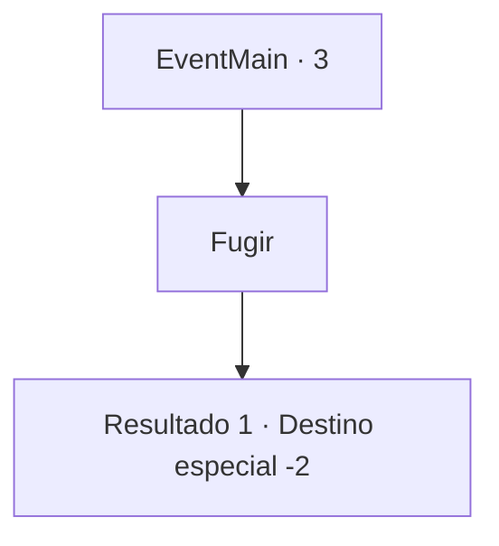

# Eventos principais · 3

[Índice da tabela](index.md) · [Índice geral](../index.md)

ID: `pt:EventMain:3` · Fonte: `EventMain4` · Versão: 1.2.47.

Mapeamento estático dos arquivos; a disponibilidade e a execução dependem do estado da run.

## Texto do evento

*Sem texto no arquivo.*

## Dados de entrada

```json
{
  "id": 3,
  "grade": 1,
  "normalGoal": "0",
  "required": ""
}
```

## Mapa das escolhas



## Escolhas e resultados

### Escolha 1

Fugir

Requisitos e outros campos da escolha:

```json
{
  "required": ""
}
```

#### Resultado 1.1

O seu ajudante é um elfo de orelhas pontiagudas com o nome de 'Irelle'. Você atravessa as montanhas de Atilante com a ajuda de Irelle, e ele entrega-lhe uma poção antes de se separar. 

 "Espero que um dia lhe retribua o favor."

 Com isso, ele parte. Você coleta a poção e continua a sua viagem.

Continuação registrada: [Destino especial `-2`](../destinos-especiais.md).

```json
{
  "required": "",
  "chance": "1",
  "nextEvent": -2,
  "type": 2,
  "reward": "3_36_1|13_0_1"
}
```

## Referências que chegam a este evento

- [Evento 1 · escolha 2 · resultado 1](0001.md#escolha-2)
- [Evento 1 · escolha 2 · resultado 2](0001.md#escolha-2)
- [Evento 2 · escolha 2 · resultado 1](0002.md#escolha-2)
