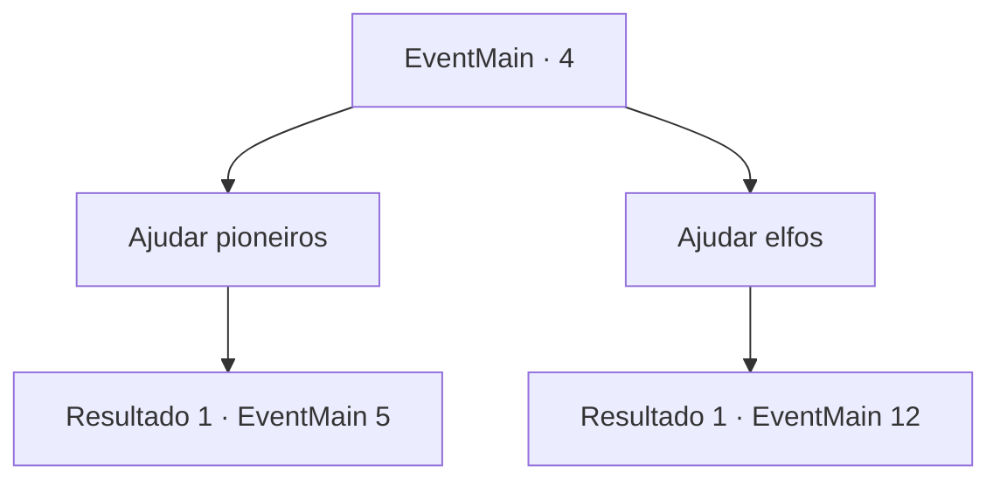

# Eventos principais · 4

[Índice da tabela](index.md) · [Índice geral](../index.md)

ID: `pt:EventMain:4` · Fonte: `EventMain4` · Versão: 1.2.47.

Mapeamento estático dos arquivos; a disponibilidade e a execução dependem do estado da run.

## Texto do evento

Você segue um som agudo vindo de longe.|drawing_fightElf| Você testemunha uma luta entre colonizadores e elfos. Entre os elfos está Irelle, que salvou você do gigante. Os colonos estão perdendo, e a coisa está feia. 

## Dados de entrada

```json
{
  "id": 4,
  "grade": 1,
  "normalGoal": "0",
  "required": "1_2_35|13_0_1"
}
```

## Mapa das escolhas



## Escolhas e resultados

### Escolha 1

Ajudar pioneiros

Requisitos e outros campos da escolha:

```json
{
  "required": ""
}
```

#### Resultado 1.1

Você decide se tornar o salvador dos pioneiros.

Continuação registrada: [Evento 5](0005.md) na mesma tabela.

```json
{
  "required": "",
  "chance": "1",
  "nextEvent": 5,
  "type": 2,
  "reward": "6_0_57",
  "place": 1
}
```

### Escolha 2

Ajudar elfos

Requisitos e outros campos da escolha:

```json
{
  "required": ""
}
```

#### Resultado 2.1

Você decide lutar ao lado dos elfos.

Continuação registrada: [Evento 12](0012.md) na mesma tabela.

```json
{
  "required": "",
  "chance": "1",
  "nextEvent": 12,
  "type": 2,
  "reward": "6_0_61",
  "place": 1
}
```

## Referências que chegam a este evento

Nenhum `nextEvent` positivo da mesma tabela aponta para este nó. Isso não prova que seja inacessível: sorteio e estado de história podem selecioná-lo.

