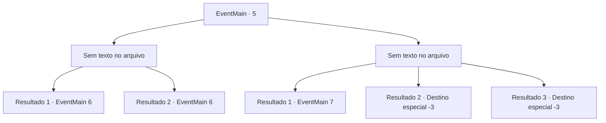

# Eventos principais · 5

[Índice da tabela](index.md) · [Índice geral](../index.md)

ID: `pt:EventMain:5` · Fonte: `EventMain4` · Versão: 1.2.47.

Mapeamento estático dos arquivos; a disponibilidade e a execução dependem do estado da run.

## Texto do evento

*Sem texto no arquivo.*

## Dados de entrada

```json
{
  "id": 5,
  "grade": 1,
  "normalGoal": "0",
  "required": ""
}
```

## Mapa das escolhas



## Escolhas e resultados

### Escolha 1

*Sem texto no arquivo; o papel dessa opção depende da interface do jogo.*

Requisitos e outros campos da escolha:

```json
{
  "required": ""
}
```

#### Resultado 1.1

Os elfos perdem a coragem e correm quando Irelle cai. Os pioneiros também parecem exaustos. Respirando pesadamente no chão, Irelle diz. 

 "Hehe... Então é assim que os humanos retribuem favores."


Continuação registrada: [Evento 6](0006.md) na mesma tabela.

```json
{
  "required": "5_98_1",
  "chance": "1",
  "nextEvent": 6,
  "type": 2,
  "reward": ""
}
```

#### Resultado 1.2

Os elfos perdem a coragem e correm quando Irelle cai. Os pioneiros também parecem exaustos. Respirando pesadamente no chão, Irelle fala. 

 "Maldito..."


Continuação registrada: [Evento 6](0006.md) na mesma tabela.

```json
{
  "required": "5_98_2",
  "chance": "1",
  "nextEvent": 6,
  "type": 2,
  "reward": ""
}
```

### Escolha 2

*Sem texto no arquivo; o papel dessa opção depende da interface do jogo.*

Requisitos e outros campos da escolha:

```json
{
  "required": ""
}
```

#### Resultado 2.1

Irelle bate em você, e os pioneiros perdem a vontade de lutar. Mas então Irelle ordena que os elfos recuem. Ele adverte os pioneiros. 

 "Eu lhes darei tempo para ir. Desmontem o acampamento e vão embora até o final do ano."

 E com isso, os elfos vão embora. Você e os pioneiros voltam para o acampamento, exaustos. Juntos, vocês discutem planos futuros.

Continuação registrada: [Evento 7](0007.md) na mesma tabela.

```json
{
  "required": "1_0_2|1_1_2",
  "chance": "1",
  "nextEvent": 7,
  "type": 2,
  "reward": "0_0_-1|0_1_-1|0_2_1"
}
```

#### Resultado 2.2

Você morre lutando contra os elfos, assim como incontáveis outros pioneiros antes de você.

Continuação registrada: [Destino especial `-3`](../destinos-especiais.md).

```json
{
  "required": "2_0_2",
  "chance": "1",
  "nextEvent": -3,
  "type": 2,
  "reward": "0_0_-1|0_1_-1"
}
```

#### Resultado 2.3

Você morre lutando contra os elfos, assim como incontáveis outros pioneiros antes de você.

Continuação registrada: [Destino especial `-3`](../destinos-especiais.md).

```json
{
  "required": "2_1_2",
  "chance": "1",
  "nextEvent": -3,
  "type": 2,
  "reward": "0_0_-1|0_1_-1"
}
```

## Referências que chegam a este evento

- [Evento 4 · escolha 1 · resultado 1](0004.md#escolha-1)
