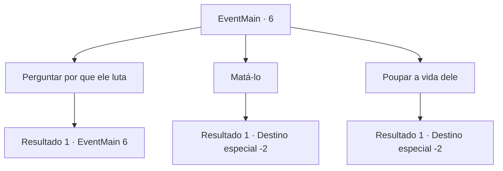

# Eventos principais · 6

[Índice da tabela](index.md) · [Índice geral](../index.md)

ID: `pt:EventMain:6` · Fonte: `EventMain4` · Versão: 1.2.47.

Mapeamento estático dos arquivos; a disponibilidade e a execução dependem do estado da run.

## Texto do evento

*Sem texto no arquivo.*

## Dados de entrada

```json
{
  "id": 6,
  "grade": 1,
  "normalGoal": "0",
  "required": ""
}
```

## Mapa das escolhas



## Escolhas e resultados

### Escolha 1

Perguntar por que ele luta

Requisitos e outros campos da escolha:

```json
{
  "required": "13_0_1"
}
```

#### Resultado 1.1

Ele te responde enquanto tenta recuperar o fôlego. 

 "Esta terra sempre pertenceu à nossa espécie. Vocês humanos são invasores. Vocês fariam o mesmo se alguém invadisse suas terras."


Continuação registrada: [Evento 6](0006.md) na mesma tabela.

```json
{
  "required": "",
  "chance": "1",
  "nextEvent": 6,
  "type": 2,
  "reward": "13_0_2"
}
```

### Escolha 2

Matá-lo

Requisitos e outros campos da escolha:

```json
{
  "required": ""
}
```

#### Resultado 2.1

Você mata Irelle.  

 "Estaríamos mortos se não fosse por você! Deixe-nos pagar-lhe uma bebida!"

  Os pioneiros te agradecem.  Juntos, vocês bebem pela sua pequena vitória.

Continuação registrada: [Destino especial `-2`](../destinos-especiais.md).

```json
{
  "required": "",
  "chance": "1",
  "nextEvent": -2,
  "type": 2,
  "reward": "0_3_-10|0_2_2|13_0_3"
}
```

### Escolha 3

Poupar a vida dele

Requisitos e outros campos da escolha:

```json
{
  "required": ""
}
```

#### Resultado 3.1

Você decide poupar Irelle,  Apesar da preocupação de alguns pioneiros.  Ele diz que você se arrependerá, e então desaparece na floresta.  

 "Estaríamos mortos se não fosse por você! Deixe-nos pagar-lhe uma bebida!"

  Os pioneiros te agradecem.  Juntos, vocês bebem pela sua pequena vitória.

Continuação registrada: [Destino especial `-2`](../destinos-especiais.md).

```json
{
  "required": "",
  "chance": "1",
  "nextEvent": -2,
  "type": 2,
  "reward": "0_3_10|0_2_2|13_0_4"
}
```

## Referências que chegam a este evento

- [Evento 5 · escolha 1 · resultado 1](0005.md#escolha-1)
- [Evento 5 · escolha 1 · resultado 2](0005.md#escolha-1)
- [Evento 6 · escolha 1 · resultado 1](0006.md#escolha-1)
