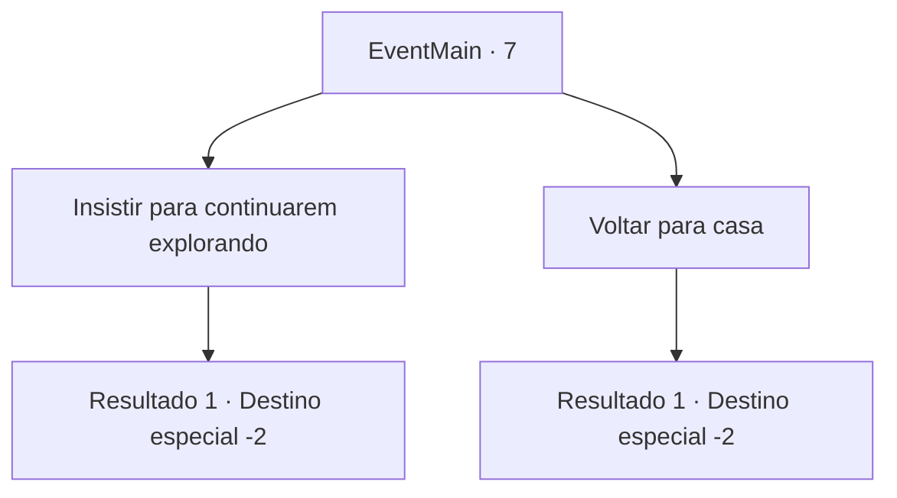

# Eventos principais · 7

[Índice da tabela](index.md) · [Índice geral](../index.md)

ID: `pt:EventMain:7` · Fonte: `EventMain4` · Versão: 1.2.47.

Mapeamento estático dos arquivos; a disponibilidade e a execução dependem do estado da run.

## Texto do evento

*Sem texto no arquivo.*

## Dados de entrada

```json
{
  "id": 7,
  "grade": 1,
  "normalGoal": "0",
  "required": ""
}
```

## Mapa das escolhas



## Escolhas e resultados

### Escolha 1

Insistir para continuarem explorando

Requisitos e outros campos da escolha:

```json
{
  "required": ""
}
```

#### Resultado 1.1

Você insiste que os pioneiros devem responder a ameaça élfica.  Alguns deles voltam para casa, mas muitos concordam com você.  Juntos, vocês constroem cercas e torres de vigia ao redor do acampamento.

Continuação registrada: [Destino especial `-2`](../destinos-especiais.md).

```json
{
  "required": "",
  "chance": "1",
  "nextEvent": -2,
  "type": 2,
  "reward": "13_0_5|0_2_1|5_73_1"
}
```

### Escolha 2

Voltar para casa

Requisitos e outros campos da escolha:

```json
{
  "required": ""
}
```

#### Resultado 2.1

Você diz aos pioneiros que já viu o suficiente de derramamento de sangue. Alguns corcordam. A maioria não. Eles te chamam de covarde e te expulsam do acampamento.

Continuação registrada: [Destino especial `-2`](../destinos-especiais.md).

```json
{
  "required": "",
  "chance": "1",
  "nextEvent": -2,
  "type": 2,
  "reward": "13_0_6|0_2_1"
}
```

## Referências que chegam a este evento

- [Evento 5 · escolha 2 · resultado 1](0005.md#escolha-2)
