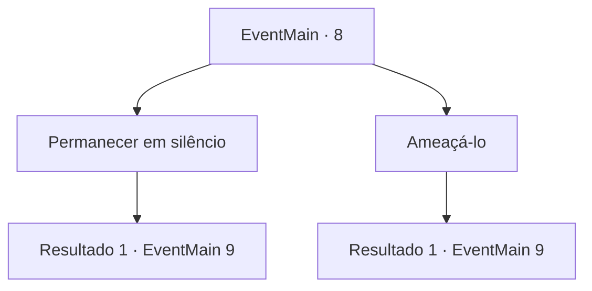

# Eventos principais · 8

[Índice da tabela](index.md) · [Índice geral](../index.md)

ID: `pt:EventMain:8` · Fonte: `EventMain4` · Versão: 1.2.47.

Mapeamento estático dos arquivos; a disponibilidade e a execução dependem do estado da run.

## Texto do evento

Você vai ao acampamento dos colonizadores para pegar comida.|drawing_alram|Até então Sinos de Emergência começam a tocar nas torres de vigilância. Os elfos estão atacando. Os colonos rápidamente trocam para posições defensivas. O exército élfico para em frente ao acampamento e um dos elfos fala 

 "Assassino de Irelle, venha adiante agora!"

 Todos te encaram.

## Dados de entrada

```json
{
  "id": 8,
  "grade": 1,
  "normalGoal": "0",
  "required": "13_0_3|1_2_75"
}
```

## Mapa das escolhas



## Escolhas e resultados

### Escolha 1

Permanecer em silêncio

Requisitos e outros campos da escolha:

```json
{
  "required": ""
}
```

#### Resultado 1.1

Você decide permanecer em silêncio. Mas a maneira como te olham te denuncia. O general élfico aponta para você e grita 

 "Saia daqui, covarde!! Me derrote e deixaremos você em paz!"

 Relutantemene, você segue para enfrentar o general.

Continuação registrada: [Evento 9](0009.md) na mesma tabela.

```json
{
  "required": "",
  "chance": "1",
  "nextEvent": 9,
  "type": 2,
  "reward": "6_3_58",
  "place": 1
}
```

### Escolha 2

Ameaçá-lo

Requisitos e outros campos da escolha:

```json
{
  "required": "1_12_12"
}
```

#### Resultado 2.1

Você grita agressivamente, dando um passo à frente.  O general élfico segue o exemplo, com a espada em punho.  Vocês começam a lutar, com seus companheiros como espectadores.

Continuação registrada: [Evento 9](0009.md) na mesma tabela.

```json
{
  "required": "",
  "chance": "1",
  "nextEvent": 9,
  "type": 2,
  "reward": "6_0_58",
  "place": 1
}
```

## Referências que chegam a este evento

Nenhum `nextEvent` positivo da mesma tabela aponta para este nó. Isso não prova que seja inacessível: sorteio e estado de história podem selecioná-lo.

