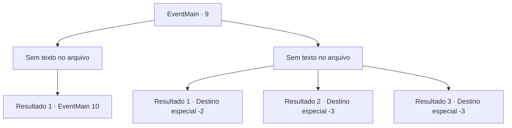

# Eventos principais · 9

[Índice da tabela](index.md) · [Índice geral](../index.md)

ID: `pt:EventMain:9` · Fonte: `EventMain4` · Versão: 1.2.47.

Mapeamento estático dos arquivos; a disponibilidade e a execução dependem do estado da run.

## Texto do evento

*Sem texto no arquivo.*

## Dados de entrada

```json
{
  "id": 9,
  "grade": 1,
  "normalGoal": "0",
  "required": ""
}
```

## Mapa das escolhas



## Escolhas e resultados

### Escolha 1

*Sem texto no arquivo; o papel dessa opção depende da interface do jogo.*

Requisitos e outros campos da escolha:

```json
{
  "required": ""
}
```

#### Resultado 1.1

O general não é páreo para você. Encurralado, ele grita ordens para a tropa dele. 

 "O que vocês estão esperando! Matem-os!"

 Com isso, as tropas élficas investem contra nós. Pioneiros correm para enfrentá-los.

Continuação registrada: [Evento 10](0010.md) na mesma tabela.

```json
{
  "required": "",
  "chance": "1",
  "nextEvent": 10,
  "type": 2,
  "reward": ""
}
```

### Escolha 2

*Sem texto no arquivo; o papel dessa opção depende da interface do jogo.*

Requisitos e outros campos da escolha:

```json
{
  "required": ""
}
```

#### Resultado 2.1

Você luta bravamente, porém sua bravura não foi o suficiente. Você não tem escolha a não ser escapar.

Continuação registrada: [Destino especial `-2`](../destinos-especiais.md).

```json
{
  "required": "1_0_2|1_1_2",
  "chance": "1",
  "nextEvent": -2,
  "type": 2,
  "reward": "13_0_10|0_0_-1|0_1_-1|0_2_2"
}
```

#### Resultado 2.2

Você luta bravamente, porém sua bravura não foi o suficiente. Você sente o aço frio penetrando no seu corpo, a medida que sua consciência fica distante.

Continuação registrada: [Destino especial `-3`](../destinos-especiais.md).

```json
{
  "required": "2_0_2",
  "chance": "1",
  "nextEvent": -3,
  "type": 2,
  "reward": "0_0_-1|0_1_-1"
}
```

#### Resultado 2.3

Você luta bravamente, porém sua bravura não foi o suficiente.  Você sente o aço frio penetrando no seu corpo, a medida que sua consciência fica distante.

Continuação registrada: [Destino especial `-3`](../destinos-especiais.md).

```json
{
  "required": "2_1_2",
  "chance": "1",
  "nextEvent": -3,
  "type": 2,
  "reward": "0_0_-1|0_1_-1"
}
```

## Referências que chegam a este evento

- [Evento 8 · escolha 1 · resultado 1](0008.md#escolha-1)
- [Evento 8 · escolha 2 · resultado 1](0008.md#escolha-2)
