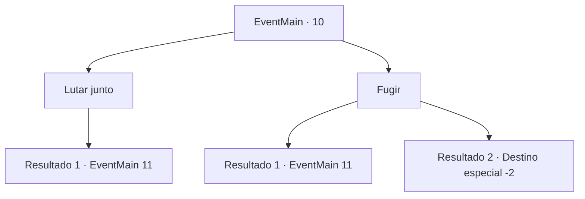

# Eventos principais · 10

[Índice da tabela](index.md) · [Índice geral](../index.md)

ID: `pt:EventMain:10` · Fonte: `EventMain4` · Versão: 1.2.47.

Mapeamento estático dos arquivos; a disponibilidade e a execução dependem do estado da run.

## Texto do evento

*Sem texto no arquivo.*

## Dados de entrada

```json
{
  "id": 10,
  "grade": 1,
  "normalGoal": "0",
  "required": ""
}
```

## Mapa das escolhas



## Escolhas e resultados

### Escolha 1

Lutar junto

Requisitos e outros campos da escolha:

```json
{
  "required": ""
}
```

#### Resultado 1.1

Você lidera a batalha contra os elfos.  Os pioneiros ganham coragem e lutam arduamente.

Continuação registrada: [Evento 11](0011.md) na mesma tabela.

```json
{
  "required": "",
  "chance": "1",
  "nextEvent": 11,
  "type": 2,
  "reward": "6_0_59",
  "place": 1
}
```

### Escolha 2

Fugir

Requisitos e outros campos da escolha:

```json
{
  "required": ""
}
```

#### Resultado 2.1

Você tenta escapar em meio ao caos da batalha.  Mas você é cercado por elfos antes que perceba, o que não te deixa escolha.

Continuação registrada: [Evento 11](0011.md) na mesma tabela.

```json
{
  "required": "",
  "chance": "18",
  "nextEvent": 11,
  "type": 1,
  "reward": "6_3_59",
  "place": 1
}
```

#### Resultado 2.2

Você é ágil o suficiente para escapar da batalha.  Ninguém percebe.

Continuação registrada: [Destino especial `-2`](../destinos-especiais.md).

```json
{
  "required": "",
  "chance": "1|0_6_1",
  "nextEvent": -2,
  "type": 0,
  "reward": "13_0_7|0_2_2"
}
```

## Referências que chegam a este evento

- [Evento 9 · escolha 1 · resultado 1](0009.md#escolha-1)
